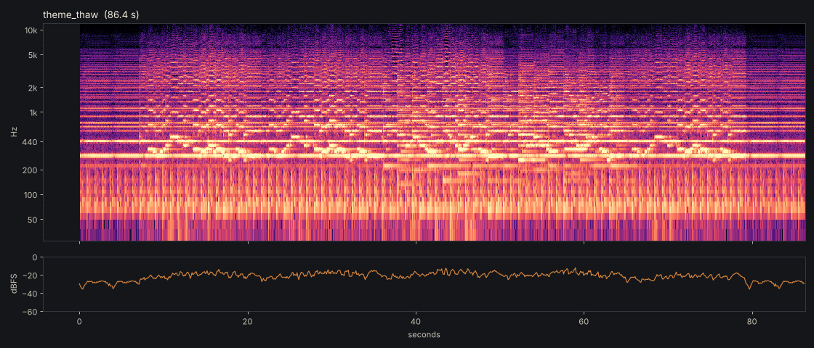
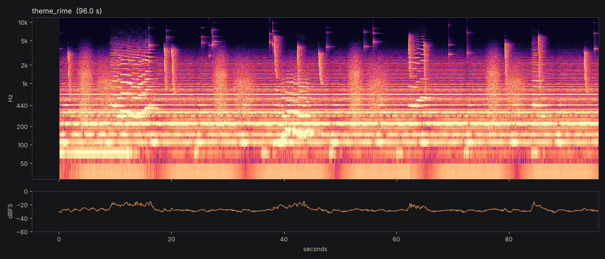
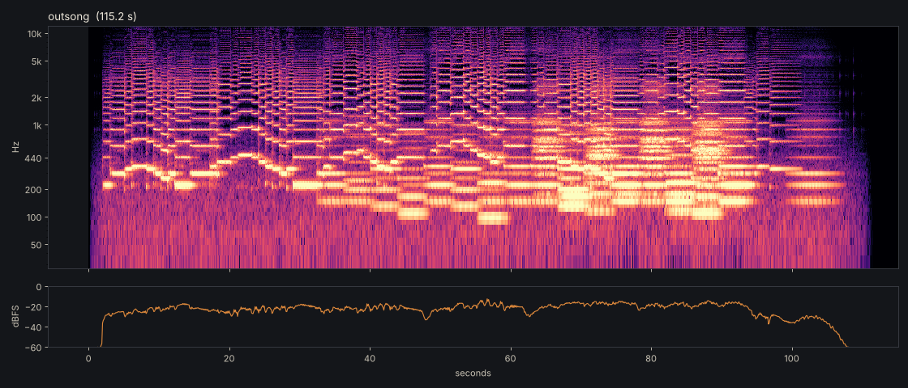
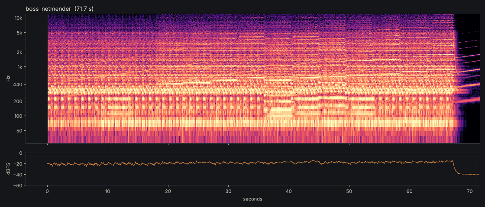
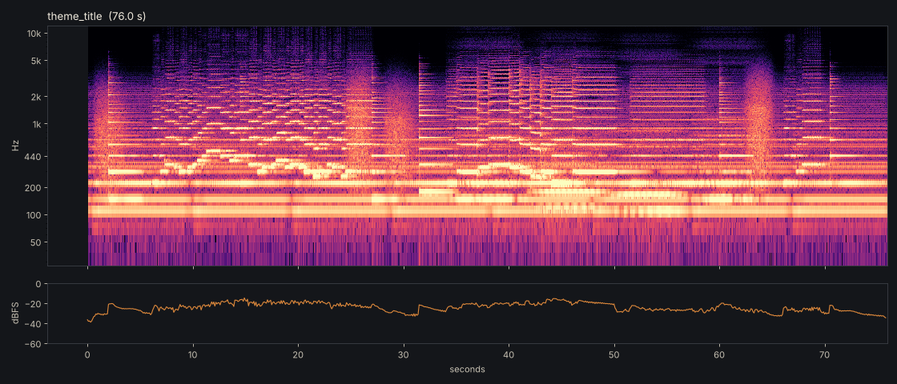
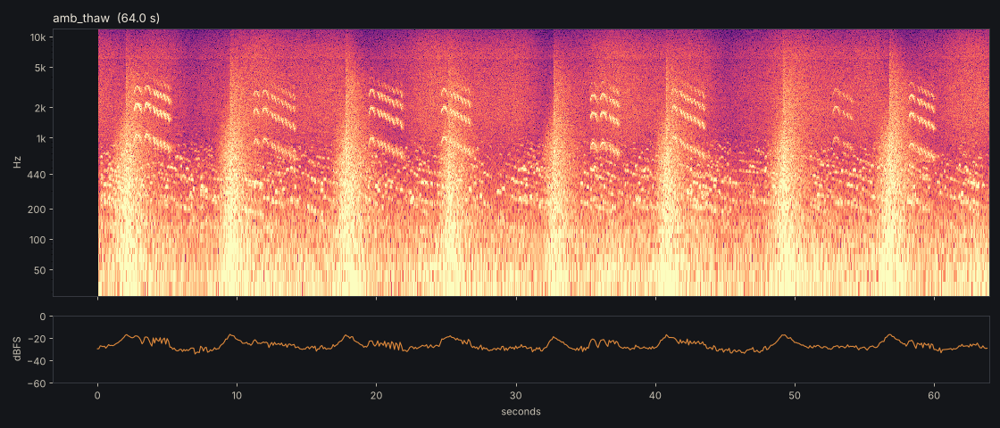
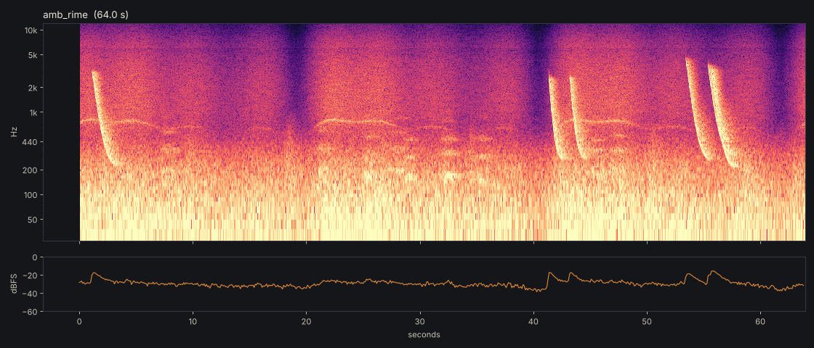

# Rimeholt: music and sound

Every sound in the game is made by committed scripts in `tools/audio/`. Run `tools/audio/build.sh` to rebuild them all. The spectrograms in this folder are for review, and `build.sh` re-renders them.

- **Composition.** The music is composed as data in `music.py`: melodies, drones, harmony and the arrangement.
- **Sampled voices.** The bowed, blown and sung voices are MIDI rendered through the FluidR3 GM soundfont (MIT licence) with fluidsynth: fiddle, cello, viola, flute, and the hummed and sung choir.
- **Physical models.** Everything else is synthesized in `dsp.py`:
  - a Karplus-Strong kantele
  - a frame drum built from circular-membrane modes
  - nyckelharpa-style sympathetic strings
  - breath, ice pings, crackle
- **Reverb.** Each piece sits in its own convolution reverb. The impulse response is generated per piece: early reflections plus a frequency-dependent decaying tail, sized as a timber hall, a cold open shore, or a hearth room.
- **Loops.** Every loop is folded: whatever rings past the loop point (release tails, reverb) is added back onto the head, so the last sample runs into the first. Continuous noise layers are crossfade-looped instead. Each build prints a seam ratio: the jump at the loop point divided by the 99th-percentile sample step. All are below 0.35, which is inaudible.
- **Format.** Music and ambience are Vorbis `.ogg`. The loop flags are set in the import files from the data by `import_flags.py`, and the `audio` suite checks them.

## The musical language

- **Mode.** The steading's mode is **D dorian** (D E F G A B C). Its raised sixth, B natural, is where the warmth is.
- **Grief.** The Outsong flattens that sixth to B flat (aeolian). It lets the B natural back in only at the line that tells the dead where the door is.
- **Instruments.** A bowed drone (fiddle or cello), a kantele, a wooden flute, a frame drum played with the hands, and voices. There is no brass, no orchestra and no taiko. Nothing is bombastic.
- **The hum.** The remembered tune opens on **A–D–F**. Those three notes are the hum, the sound the Bearer makes resting at a Hearthstone (WORLD.md §4.6). The hum recurs:
  - in the RIME theme's last fragment
  - on the title's flute at the end of the loop
  - in the Outsong's coda, sung by the Leadvoice alone before the room lets go

  Old Calder's three notes, when they are voiced, should be these.

## The pieces

### THAW: *Midsummer Evening* (`music/theme_thaw.ogg`, 86.4 s loop)

**The tune.** A remembered tune in 6/8, D dorian, 48 bars. The dotted quarter is 67 a minute, a resting heart. The frame drum keeps it: a *lub* on each dotted beat and a softer, higher *dub* a moment after.

**The drone.** The fiddle drone (D and A) is re-bowed every two bars, alternating bow directions so there is never a gap. Sympathetic strings tuned to the mode ring under everything played above them, which is the nyckelharpa's halo.

**Form.** The form is AABB-A, the way a tune is played at a door on a summer night:

1. The fiddle has the tune alone.
2. The flute joins an octave up.
3. The B strain reaches up to D5, and the kantele plucks the chord tones.
4. The flute takes the B strain while the fiddle walks a low second line.
5. The fiddle plays A once more, softer and alone, and the drone and heartbeat carry it round.

The ornaments are a fiddler's: upper-neighbour graces before long notes, slight rubato, and a bow that swells through each phrase. The tune should sound like something everyone in Saltfell knew and nobody wrote.

### RIME: *The Long Winter* (`music/theme_rime.ogg`, 96 s loop)

**The bed.** A low drone of cello and bass on D2 and A2, filtered dull, with a still synthesized bow an octave under it. Someone breathes nearby, slowly, in and out, four times a loop. Ice ticks and pings at the edges.

**The memory.** The THAW tune comes back three times, each time slower than half speed, through ice (lowpassed, far off, to one side). Every held note sags flat as it is held. Every fragment **breaks off** mid-phrase, its last note clipped:

1. The fiddle gets as far as the warm B natural, holds it, sags, and stops.
2. The flute, an octave down, gets six notes in.
3. The B strain's opening leap, then nothing.
4. The hum, two notes of three.

The loop never finishes the tune. That is the point.

### The Outsong (`music/outsong.ogg`, 115 s, plays once)

The rite, at the hearth, played when a Holdfast is released. It does not loop. The world's music returns only after it has finished (`AudioDirector.play_outsong`). Its shape is the rite in WORLD.md §2:

1. **The Leadvoice starts alone.** A solo viola stands in for her voice. It has a voice's habits: portamento slides between near notes, swells on every note, a free and slightly held-back tempo. Two phrases name the dead, low and plain.
2. **Then the household joins.** A hummed choir (closed-mouth voices) enters under the third phrase. That phrase is the only one with the dorian B natural: it tells the dead where the door is. The fourth phrase rises to the highest note of the song (E5) and holds a D at the top.
3. **Then the neighbours outside the door.** A second, wider choir, heard through a wall: it has its own distant reverb, is filtered dark, and is panned wide. It joins on the fifth phrase, which carries the dead down the scale and "up the water".
4. **Everyone sings the first phrase again,** the solo an octave above, ornamented. This is the loudest the song gets, and it is still only voices.
5. **Coda.** The voice alone sings the hum (A–D–F), then a long E that does not resolve. The room answers with an open D and no third. Neither major nor minor: let go. A small fire crackles under the whole rite.

### The Netmender (`music/boss_netmender.ogg`, 71.7 s loop)

**The knot.** A **knot figure** in 7/8, grouped 2+2+3: D-F, E-D, G-F-E. Over, under, through, and back to where it started. It never stops being tied. Fiddle spiccato plays it, a dry kantele pluck doubles it like a net-needle pulling cord, and a cello marks each downbeat.

**The strain.** From bar 16 a viola ties the same knot over itself, a fifth up and an eighth late. A violin holds long notes that each start a step higher (A4 to A5 over 40 bars), crescendo, and press slightly sharp as they are held. Under everything a Shepard–Risset glissando **rises without arriving**. The harmony tightens: the knot is dragged onto C, then up onto the phrygian E flat, then back.

**The cut.** At bar 60 everything stops on a frost-crack. Only the rising strain is left, for four bars of air, and then the knot begins again from nothing. Every time she finishes the net, she cuts it open. The loop is that.

The drum is a hand on a frame, with no taiko and no brass. The piece is insistent rather than loud.

### Title: *The Coal in the Horn* (`music/theme_title.ogg`, 76 s loop)

A low cello drone and a breath. A lone wooden flute plays the remembered tune once, slowly, as if trying to recall it. Then the viola plays the Outsong's first phrase far off, over a hummed chord: the game already knows how it ends. Sparse low kantele notes tick like a coal being fed. The flute closes the loop with the hum.

## Ambiences

### THAW (`ambience/amb_thaw.ogg`, 64 s loop)

- **Surf on shingle.** Eight waves a loop, never evenly spaced. Each has a swell, a break and a wash, then the long rattling drag of stones going back down the strand. The drag is hundreds of clicks through pebble-sized resonances.
- **Gulls.** Herring-gull long calls: drawn-out mews, then the laughing run.
- **Wind in the grass.** A soft high hiss on slow, exactly periodic gusts.
- **Voices.** People talking down by the boats: glottal pulses through moving vowel formants, in syllabic rhythm, with falling phrase pitch and pauses, and the odd laugh. They are filtered by distance so there are never words. Texture, not language.

### RIME (`ambience/amb_rime.ogg`, 64 s loop)

- **Wind.** Lower and longer gusts, with a whistle that rises in pitch and loudness with the gust, like air in a frozen net.
- **Ice.** Stick-slip creaks through the low modes of a frozen sheet, and the long dispersive *pew-ow* a frozen strand sings. Fine crackle of rime growing.
- **The sea.** The same surf, muffled to a thump behind the ice wall.

## Wiring

| What | Where |
|---|---|
| Per-state music, ambience and crossfades (`music_fade_in`, `ambience_fade`) | `data/state_profiles.json` |
| Title, Outsong, holdfast themes (with loop flags), the wave, footsteps, foley | `data/audio.json` |
| Crossfading music and ambience players, boss ducking, the Outsong, the surface probe | `src/core/audio_director.gd` |

## Foley

All foley is in `synth.py`, with outputs in `assets/audio/` and `assets/audio/foley/`.

- **Footsteps,** four variants per surface, chosen by `AudioDirector.surface_at`. The terrain's painted shingle layer gives shingle and turf. House floors are plank. Outdoors in RIME everything is snow.
  - **turf:** damp thud and a brush of grass
  - **shingle:** a shower of pebble clicks
  - **plank:** board modes, a heel tick, sometimes a creak
  - **snow:** crust break and the dry squeak of packed crystals
- **Frost-taken hits** (`hit_frost_1-3`): rime shattering, a stiff-wool thump, and skittering chips. **`frost_fall`** is the whole crust giving way when one falls.
- **Parry:** a bog-iron bar's inharmonic free-free modes (darker than steel), an ice crack, and a hanging shimmer of ice pings.
- **Coal catch** (`foley/coal_catch.wav`): a breath drawn across the hearthstone, the *whump* of the kindling catching, a crackle. It plays when a Hearthstone is rested at.
- **Death (STILLED):** one long breath out into the cold, and frost ticking where it went.
- **The state wave:**
  - **To RIME** (`wave_to_rime.ogg`): the world draws one long breath in and holds it, while ice cracks race outward and the sheet tightens underneath.
  - **To THAW** (`wave_to_thaw.ogg`): the breath lets go, the ice gives with duller cracks, and meltwater drips.
  - Neither is a bell.
- **The engine set:** swing, slash, block, shield, roll, UI and the rest keep their names and jobs, retuned. Iron and wool rather than steel, wooden ticks, and the kantele for rest and level-up.
