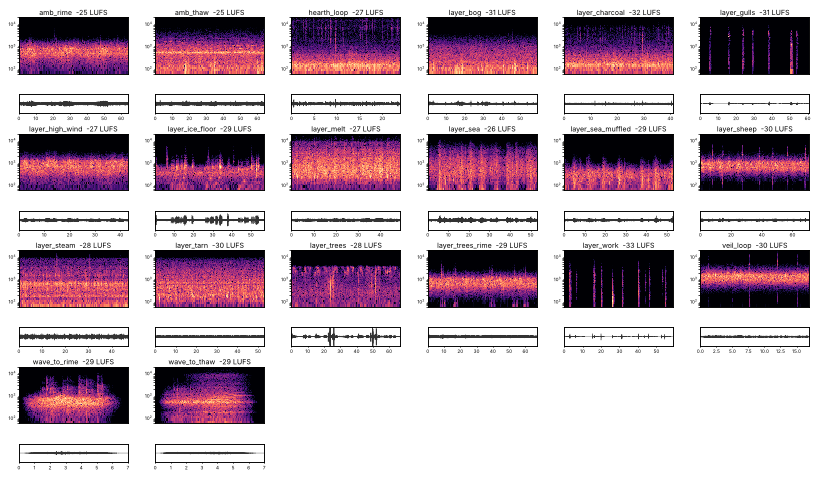
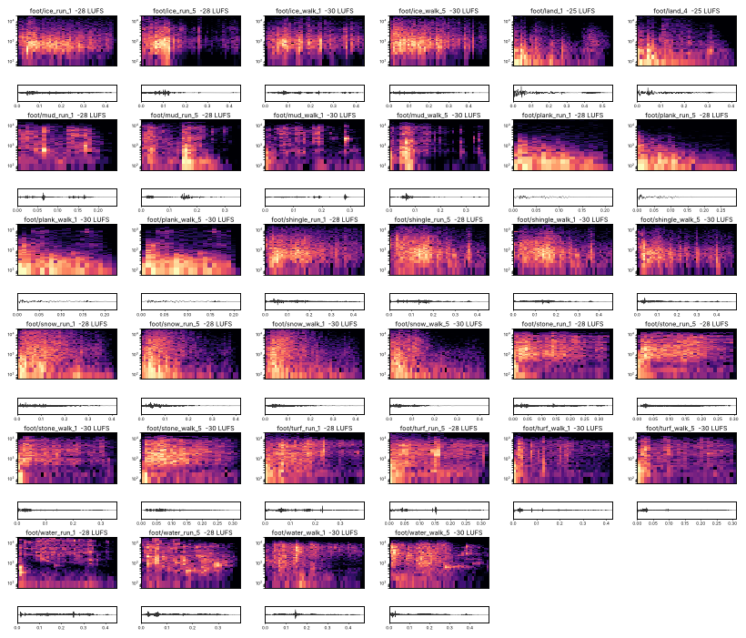

# Rimeholt: sound effects and ambience

Every sound effect and ambience bed is built from **CC0 recordings** by `tools/audio/build_sfx.py`, from the manifest `tools/audio/sfx_manifest.json`. Nothing in this document is synthesized. The music and five composed stingers are still synthesized and are described in `MUSIC.md`.

```
python3 tools/audio/build_sfx.py              # fetch, build, measure, write data and tables
python3 tools/audio/build_sfx.py --only foot/ # one family
python3 tools/audio/sfx_sheet.py              # spectrogram contact sheets
tools/audio/build.sh                          # everything, music included
```

## What the build does

1. **Fetch.** Each source in the manifest names its page, author, licence and files. Only `CC0` is accepted: the build refuses any other licence. Downloads are cached in `raw/sfx/` (gitignored).
2. **Cut.** A sound is one or more layers. Each layer is a take from a source, trimmed to the sound itself, filtered, optionally re-pitched, and brought to one common loudness so that the layer gains in the manifest are mix levels.
3. **Vary.** Variant *i* of a sound uses take *i* of each layer, so a set of five footsteps is five different recordings, not one recording five times.
4. **Normalise.** Each file is set to its family's loudness (ITU-R BS.1770, the measure behind LUFS). Peaks above -1 dBFS are rounded off, not clipped.
5. **Write.** One-shots are 16-bit mono WAV, or Vorbis when longer than 2.5 s. Beds are stereo Vorbis loops: the two channels are two different stretches of the same recording, and the loop point is an equal-power crossfade.
6. **Report.** The tables at the end of this file, `sfx_report.json`, and the `sfx` block of `data/audio.json` are all written by the build.

## Sources that could not be used

- **freesound.org** and its CDN return 403 through this session's proxy, so no file came from it directly. Some Freesound recordings released under CC0 are used through their OpenGameArt repacks, which name the recordist.
- **Wikimedia Commons** rate-limited the API from this address. Nothing was taken from it.
- **Sonniss GDC bundles** are tens of gigabytes; the build machine had under 1 GB free.

Two consequences, both honest stand-ins made from real recordings:

- **Stag.** No CC0 red deer was reachable. The stag's bellow is a camel's groan, pitched up.
- **Ram.** The ram is a sheep, pitched down.

The Holdfast signature sounds are designed, each from several recordings: no single recording of a net being hauled or an ice auger was available. The recipe for each is in the manifest and the table below names every file.

## Families and loudness

| Family | Target (LUFS) | What is in it |
|---|---|---|
| footsteps | -30 walk, -28 run, -25 landing | eight surfaces, a walk and a run set of five each, and the landing |
| foley | -30 to -24 | roll, cloth, equip, bow draw, the gourd, stagger |
| swings | -27 to -23 | light, medium and heavy blades, the bow's loose, foe swings and throws |
| impacts | -26 to -17 | hits by material, block, parry, riposte, shield bash, and the seven strike surfaces |
| player | -24 | hurt (a blow and the air it knocks out) and the death breath. No voice. |
| foe | -24 to -20 | per family: alert, attack, hit, death |
| boss | -24 to -18 | one signature per Holdfast |
| world | -27 to -19 | hearth, doors, gate, bar, ladder, bridge, pickup, plaque, veil, ice, water, fire |
| ui | -32 to -29 | wood, bone and ember ticks |
| beds | -25 base, -33 to -26 layers, -29 wave | see below |

Runtime level, pitch spread and distance preset for each key are in the manifest (`mix`) and are copied to `data/audio.json`.

## How the game plays them

All of it is in `src/core/audio_director.gd` and `data/audio.json`.

- **`AudioDirector.play(key, pos = null, db = 0.0, pitch = 1.0)`** plays an effect by key. With a position it is 3D; without, it plays flat on the key's bus. It never plays the same take twice running, and it varies pitch and level by the key's `pitch` and `vol`.
- **Distance.** Positional sounds use inverse-distance falloff and Godot's distance low-pass. The three presets (`near`, `mid`, `far`) are in `data/audio.json` under `spatial`.
- **Footsteps.** `AudioDirector.footstep(pos, idx, db, run)` asks `surface_at(pos)` for one of `turf`, `shingle`, `plank`, `snow`, `ice`, `stone`, `mud`, `water`, then plays `foot/<surface>_walk` or `_run`. `AudioDirector.land(pos)` is played after a real drop.
- **Swings by weight.** `AudioDirector.swing(weapon_class, heavy, pos)` reads `swings`.
- **Foe families.** An enemy names its family with `sfx_family` (`taken` by default; `dog`, `stag`, `ram`). `AudioDirector.foe(family, event, pos)` plays `alert`, `attack`, `hit` or `death`.
- **Buses** are unchanged: Music, Ambience, SFX, UI.

### Strike surfaces (for prop hit VFX)

```gdscript
AudioDirector.impact(surface, position)   # surface: wood, stone, metal, ice, cloth, turf, snow
```

The map is `impacts` in `data/audio.json`. An unknown surface plays the map's `default`.

```json
"impacts": {"wood": "impact/wood", "stone": "impact/stone", "metal": "impact/metal", "ice": "impact/ice",
            "cloth": "impact/cloth", "turf": "impact/turf", "snow": "impact/snow", "default": "impact/wood"}
```

## Ambience, and the change between THAW and RIME

### What was wrong

1. **Both beds were synthesized from filtered noise.** Surf, wind and grass were all shaped noise (`tools/audio/ambience.py`, now removed), so each bed read as a band of hiss with a different colour. That is the most likely meaning of "heat/winter noise".
2. **The swap had a hole in it.** The two beds were crossfaded by sliding each one's level in decibels in a straight line. Half-way through, both are about 20 dB down, so their sum is some 17 dB below either bed alone. The ear hears the old bed drop out, a gap, and the new bed arrive.
3. **It happened late.** The swap began only when the wave had finished, six seconds after the frost line had already passed the player. The picture changed, then the sound.
4. **The transition sound was the loudest thing playing.** The "breath" measured -16 and -14 LUFS and played at full level on the SFX bus, against beds that reached the ear at about -31. It was 15 to 17 LU above the air it was meant to bridge, and louder than the music.
5. **Every swap restarted the loop from its first sample.**

### What it does now

- **Recorded beds.** A base bed per state (`amb_thaw.ogg`: open air and wind in grass; `amb_rime.ogg`: lower, colder wind and the odd creak of ice) plus the region's own layers.
- **Equal-power handover.** Old bed at cos, new bed at sin of the same angle, so the summed power is constant. The audio suite measures the real player levels on every frame of a wave and fails if the sum leaves 0.97 to 1.03.
- **It follows the wave front.** `StateDirector` calls `AudioDirector.wave_begin`, `wave_update(radius, dt)` each frame and `wave_end`. The handover is half-way when the front reaches the listener, is spread over `wave.ambience_band` metres (36), and never completes faster than `wave.ambience_min_time` seconds (2.2).
- **A quiet bridge.** `wave_to_rime.ogg` (the wind turns cold, a few ice ticks, a low creak) and `wave_to_thaw.ogg` (the wind eases, the ice gives, water starts) are built at -29 LUFS and play on the Ambience bus at about the level of the beds, with a slow fade in and out.
- **Beds start at a random point** in their loop.

### Region layers

From `docs/art/BIOMES.md`. The table is `ambience.regions` in `data/audio.json`: each entry is a layer file and its level relative to the base bed.

| Region | THAW | RIME |
|---|---|---|
| Saltfell | surf on the strand, gulls, distant work | the same sea, muffled behind the ice |
| The Lowe | bog water, a crow, wind low in the heather | high wind, far down |
| Kettle Fjord | hot water and steam, the fjord lapping | the ice floor groaning, a little steam |
| Tarnhall | the tarn lapping at the rushes, distant work | the ice floor |
| Thornwold | birch wood and small birds, the charcoal clamps | wind in bare tops, frozen trunks, faint clamps |
| Shepherd's Reach | sheep across the hill, wind over the walls | high wind |
| The Coldwell | meltwater over gravel | the ice floor, high wind behind it |

Two positional loops hang on world objects: `hearth_loop.ogg` on every Hearthstone (quieter in RIME, where the coals are banked) and `veil_loop.ogg` on a standing frost veil.

## What was checked, and what was not

Nobody has listened to these. They were checked by measurement:

- **Loudness, peak, DC offset, edge samples and onset time** for every file, in the tables below. A click would show as a first or last sample well above zero.
- **Loop seams** for every bed: the jump at the loop point over the 99th-percentile sample step.
- **Spectrogram contact sheets**, first and last take of every key: `sfx_sheet_<family>.png` in this folder.

What measurement cannot say: whether a layered sound reads as the thing it is meant to be; whether the takes in a set are similar enough to be one surface and different enough not to repeat; whether the runtime levels sit right against the music. Those need ears. The mix levels are in the manifest and are meant to be turned.

Not wired yet: `world/ladder`, `world/door_open`, `world/door_close`, `world/water_splash`, `ui/tab` and `boss/sung_note` exist and are measured, but no code calls them.




<!-- GENERATED BELOW by tools/audio/build_sfx.py: do not edit past this line -->

## Sources

Every source is CC0 (public-domain dedication). The page is where the licence was read.

| Source id | Page | Author | Licence | Used by |
|---|---|---|---|---|
| `10-impactshield-blocks` | https://opengameart.org/content/10-impactshield-blocks | StarNinjas | CC0 | combat/* |
| `100-cc0-metal-and-wood-sfx` | https://opengameart.org/content/100-cc0-metal-and-wood-sfx | rubberduck | CC0 | ambience/layer_charcoal, ambience/layer_work, boss/*, combat/*, impact/*, ui/*, world/* |
| `100-cc0-sfx` | https://opengameart.org/content/100-cc0-sfx | rubberduck | CC0 | ambience/layer_melt, ambience/wave_to_thaw, boss/* |
| `100-cc0-sfx-2` | https://opengameart.org/content/100-cc0-sfx-2 | rubberduck | CC0 | ambience/layer_tarn, foot/* |
| `12-wet-towel-hittingfallingpunching-floor-sounds` | https://opengameart.org/content/12-wet-towel-hittingfallingpunching-floor-sounds | qubodup (Iwan Gabovitch) | CC0 | boss/*, combat/* |
| `20-sword-sound-effects-attacks-and-clashes` | https://opengameart.org/content/20-sword-sound-effects-attacks-and-clashes | StarNinjas | CC0 | combat/* |
| `25-cc0-mud-sfx` | https://opengameart.org/content/25-cc0-mud-sfx | rubberduck | CC0 | boss/*, foot/*, impact/* |
| `4-dry-snow-steps` | https://opengameart.org/content/4-dry-snow-steps | qubodup (Iwan Gabovitch) | CC0 | foe/*, foot/*, impact/* |
| `40-cc0-water-splash-slime-sfx` | https://opengameart.org/content/40-cc0-water-splash-slime-sfx | rubberduck | CC0 | ambience/layer_bog, ambience/layer_melt, ambience/layer_steam, ambience/wave_to_thaw, foot/* |
| `42-snow-and-gravel-footsteps` | https://opengameart.org/content/42-snow-and-gravel-footsteps | Corsica_S (recording), cut by Iwan Gabovitch | CC0 | foot/* |
| `6-short-water-splashes` | https://opengameart.org/content/6-short-water-splashes | ezwa, submitted by supergamez2014 | CC0 | foot/*, world/* |
| `75-cc0-breaking-falling-hit-sfx` | https://opengameart.org/content/75-cc0-breaking-falling-hit-sfx | rubberduck | CC0 | boss/*, foe/*, foot/*, impact/*, world/* |
| `80-cc0-rpg-sfx` | https://opengameart.org/content/80-cc0-rpg-sfx | rubberduck | CC0 | combat/*, foot/*, impact/*, ui/*, world/* |
| `9-wet-snow-steps` | https://opengameart.org/content/9-wet-snow-steps | qubodup (Iwan Gabovitch) | CC0 | foot/* |
| `battle-sound-effects` | https://opengameart.org/content/battle-sound-effects | remaxim (multi-licensed; taken under CC0) | CC0 | combat/*, foe/* |
| `beach-ocean-waves` | https://opengameart.org/content/beach-ocean-waves | jasinski (recording), submitted by Four Bidden | CC0 | ambience/layer_sea, ambience/layer_sea_muffled |
| `blacksmiths-hammer` | https://opengameart.org/content/blacksmiths-hammer | vishwajai | CC0 | ambience/layer_steam |
| `boiling-water-loops` | https://opengameart.org/content/boiling-water-loops | TinyWorlds | CC0 | ambience/layer_steam |
| `camel-groan` | https://opengameart.org/content/camel-groan | AntumDeluge | CC0 | foe/* |
| `catching-fire` | https://opengameart.org/content/catching-fire | themightyglider | CC0 | world/* |
| `creaky-door-hinge-spooky` | https://opengameart.org/content/creaky-door-hinge-spooky | w.forster | CC0 | world/* |
| `crow-caw` | https://opengameart.org/content/crow-caw | ZeroIsNotNull | CC0 | ambience/layer_bog |
| `different-steps-on-wood-stone-leaves-gravel-and-mud` | https://opengameart.org/content/different-steps-on-wood-stone-leaves-gravel-and-mud | TinyWorlds | CC0 | ambience/layer_tarn, boss/*, foot/* |
| `dog-snarl-grunt-grumble` | https://opengameart.org/content/dog-snarl-grunt-grumble | qubodup (Iwan Gabovitch) | CC0 | foe/* |
| `dog-sounds` | https://opengameart.org/content/dog-sounds | pauliuw | CC0 | foe/* |
| `fantasy-weapons-and-apparel-sfx-library` | https://opengameart.org/content/fantasy-weapons-and-apparel-sfx-library | Vehicle (Jan Schupke) | CC0 | combat/*, foley/*, foot/*, impact/* |
| `fantozzis-footsteps-grasssand-stone` | https://opengameart.org/content/fantozzis-footsteps-grasssand-stone | Fantozzi, submitted by Raassh | CC0 | foe/*, foot/* |
| `fire-crackling` | https://opengameart.org/content/fire-crackling | AntumDeluge | CC0 | world/* |
| `fireplace-sound-loop` | https://opengameart.org/content/fireplace-sound-loop | PagDev | CC0 | ambience/hearth_loop, ambience/layer_charcoal |
| `forest-bird-sounds` | https://opengameart.org/content/forest-bird-sounds | pauliuw | CC0 | ambience/layer_trees |
| `ghost-breath` | https://opengameart.org/content/ghost-breath | qubodup (Iwan Gabovitch) | CC0 | foe/*, player/*, world/* |
| `ghostly-humming` | https://opengameart.org/content/ghostly-humming | NocturnalVanguard | CC0 | boss/* |
| `ice-breakingshattering` | https://opengameart.org/content/ice-breakingshattering | IgnasD | CC0 | ambience/amb_rime, ambience/layer_ice_floor, ambience/veil_loop, ambience/wave_to_rime, ambience/wave_to_thaw, boss/*, combat/*, foe/*, foot/*, impact/*, player/*, world/* |
| `kenney-impact-sounds` | https://kenney.nl/assets/impact-sounds | Kenney (kenney.nl), Impact Sounds 1.0 | CC0 | boss/*, combat/*, foe/*, foley/*, foot/*, impact/*, player/*, ui/*, world/* |
| `kenney-rpg-audio` | https://kenney.nl/assets/rpg-audio | Kenney (kenney.nl), RPG Audio | CC0 | ambience/layer_work, boss/*, combat/*, foe/*, foley/*, foot/*, impact/*, player/*, ui/*, world/* |
| `liquid-bottle-drink-set` | https://opengameart.org/content/liquid-bottle-drink-set | qubodup (Iwan Gabovitch) | CC0 | combat/*, world/* |
| `metal-impact-sounds` | https://opengameart.org/content/metal-impact-sounds | bmaczero | CC0 | combat/* |
| `mild-wind-background-noise` | https://opengameart.org/content/mild-wind-background-noise | Bashar3A | CC0 | ambience/amb_thaw, ambience/layer_bog |
| `rpg-sound-pack` | https://opengameart.org/content/rpg-sound-pack | artisticdude | CC0 | combat/*, foley/*, impact/*, player/*, ui/* |
| `scrapes` | https://opengameart.org/content/scrapes | AntumDeluge | CC0 | boss/* |
| `sea-and-river-wave-sounds` | https://opengameart.org/content/sea-and-river-wave-sounds | RandomMind | CC0 | ambience/layer_melt, ambience/layer_sea, ambience/layer_sea_muffled |
| `sheep-baa` | https://opengameart.org/content/sheep-baa | AntumDeluge | CC0 | ambience/layer_sheep, foe/* |
| `shovel-sound` | https://opengameart.org/content/shovel-sound | themightyglider | CC0 | boss/* |
| `solo-seagull-sound-effects` | https://opengameart.org/content/solo-seagull-sound-effects | Rango Mango | CC0 | ambience/layer_gulls |
| `steam-release-sounds` | https://opengameart.org/content/steam-release-sounds | bart | CC0 | ambience/layer_steam |
| `swishes-sound-pack` | https://opengameart.org/content/swishes-sound-pack | artisticdude | CC0 | combat/*, foe/*, world/* |
| `their-coming-generic-horn-sound` | https://opengameart.org/content/their-coming-generic-horn-sound | StumpyStrust | CC0 | boss/* |
| `tree-creaking` | https://opengameart.org/content/tree-creaking | AntumDeluge | CC0 | ambience/amb_rime, ambience/layer_ice_floor, ambience/layer_trees, ambience/layer_trees_rime, ambience/wave_to_rime, boss/*, foe/* |
| `water-splash-and-sand-footsteps` | https://opengameart.org/content/water-splash-and-sand-footsteps | Peludo | CC0 | world/* |
| `water-waves` | https://opengameart.org/content/water-waves | transitking (recording), submitted by supergamez2014 | CC0 | ambience/layer_sea |
| `wind` | https://opengameart.org/content/wind | IgnasD | CC0 | foe/*, world/* |
| `wind1` | https://opengameart.org/content/wind1 | Luke.RUSTLTD | CC0 | ambience/amb_rime, ambience/layer_high_wind, ambience/layer_ice_floor, ambience/layer_sheep, ambience/layer_trees_rime, ambience/veil_loop, ambience/wave_to_rime |
| `windy-ambient-noise` | https://opengameart.org/content/windy-ambient-noise | Some Weirdo | CC0 | ambience/amb_thaw, ambience/wave_to_thaw |

## Sounds

Loudness is BS.1770 integrated (a sound shorter than 400 ms is measured as one block). `edge` is the largest first or last sample (a click if it is not near zero), `dc` the mean.

| Key | Family | n | Target LUFS | Measured LUFS (min to max) | Peak dBFS | Length s | Max edge | Max dc | Recordings |
|---|---|---|---|---|---|---|---|---|---|
| `boss/bench_crash` | boss | 3 | -18 | -18.4 to -18.1 | -1.0 | 0.88 | 0.0006 | 0.00000 | `100-cc0-metal-and-wood-sfx`:wood_breaking_01.ogg, `100-cc0-metal-and-wood-sfx`:wood_breaking_02.ogg, `100-cc0-metal-and-wood-sfx`:wood_falling_01.ogg, `100-cc0-metal-and-wood-sfx`:wood_falling_02.ogg, `100-cc0-metal-and-wood-sfx`:wood_falling_03.ogg, `100-cc0-sfx`:dishes_01.ogg, `100-cc0-sfx`:dishes_02.ogg, `100-cc0-sfx`:dishes_03.ogg, `kenney-impact-sounds`:impactPlank_medium_000.ogg, `kenney-impact-sounds`:impactPlank_medium_001.ogg, `kenney-impact-sounds`:impactPlank_medium_002.ogg |
| `boss/calling_horn` | boss | 2 | -19 | -19.0 to -19.0 | -5.0 | 6.06 | 0.0000 | 0.00000 | `their-coming-generic-horn-sound`:theircoming3_0.ogg, `their-coming-generic-horn-sound`:theircoming_0.ogg |
| `boss/horn_short` | boss | 2 | -21 | -21.0 to -21.0 | -8.5 | 3.90 | 0.0000 | 0.00000 | `their-coming-generic-horn-sound`:theircoming3_0.ogg, `their-coming-generic-horn-sound`:theircoming_0.ogg |
| `boss/ice_auger` | boss | 3 | -20 | -20.0 to -20.0 | -2.2 | 1.64 | 0.0002 | 0.00000 | `ice-breakingshattering`:LedasLuzta2.ogg, `ice-breakingshattering`:LedasLuzta4.ogg, `ice-breakingshattering`:LedasLuzta5.ogg, `kenney-impact-sounds`:impactGlass_heavy_000.ogg, `kenney-impact-sounds`:impactGlass_heavy_001.ogg, `kenney-impact-sounds`:impactGlass_heavy_002.ogg, `kenney-rpg-audio`:creak1.ogg, `kenney-rpg-audio`:creak2.ogg, `kenney-rpg-audio`:creak3.ogg, `scrapes`:scrape-4.ogg, `scrapes`:scrape-5.ogg, `scrapes`:scrape-6.ogg |
| `boss/net_drag` | boss | 3 | -20 | -20.0 to -20.0 | -1.4 | 2.47 | 0.0000 | 0.00000 | `12-wet-towel-hittingfallingpunching-floor-sounds`:wet_towel_on_floor-01.flac, `12-wet-towel-hittingfallingpunching-floor-sounds`:wet_towel_on_floor-02.flac, `12-wet-towel-hittingfallingpunching-floor-sounds`:wet_towel_on_floor-03.flac, `kenney-rpg-audio`:cloth1.ogg, `kenney-rpg-audio`:cloth2.ogg, `kenney-rpg-audio`:cloth3.ogg, `kenney-rpg-audio`:creak1.ogg, `kenney-rpg-audio`:creak2.ogg, `kenney-rpg-audio`:creak3.ogg, `scrapes`:scrape-1.ogg, `scrapes`:scrape-2.ogg, `scrapes`:scrape-3.ogg |
| `boss/sod_thud` | boss | 3 | -19 | -19.7 to -19.6 | -1.0 | 0.87 | 0.0034 | 0.00000 | `25-cc0-mud-sfx`:mud_11.ogg, `75-cc0-breaking-falling-hit-sfx`:bfh1_rock_falling_01.ogg, `75-cc0-breaking-falling-hit-sfx`:bfh1_rock_falling_02.ogg, `75-cc0-breaking-falling-hit-sfx`:bfh1_rock_falling_03.ogg, `kenney-impact-sounds`:impactSoft_heavy_000.ogg, `kenney-impact-sounds`:impactSoft_heavy_001.ogg, `kenney-impact-sounds`:impactSoft_heavy_002.ogg, `shovel-sound`:shovel_0.ogg |
| `boss/sung_note` | boss | 2 | -24 | -24.0 to -24.0 | -12.5 | 6.32 | 0.0000 | 0.00000 | `ghostly-humming`:ghostly_humming.ogg |
| `boss/thorn_growth` | boss | 3 | -21 | -21.1 to -21.1 | -1.1 | 0.66 | 0.0000 | 0.00000 | `100-cc0-metal-and-wood-sfx`:wood_cracking_01.ogg, `100-cc0-metal-and-wood-sfx`:wood_cracking_02.ogg, `100-cc0-metal-and-wood-sfx`:wood_cracking_03.ogg, `100-cc0-metal-and-wood-sfx`:wood_cracking_04.ogg, `different-steps-on-wood-stone-leaves-gravel-and-mud`:leaves01.ogg, `different-steps-on-wood-stone-leaves-gravel-and-mud`:leaves02.ogg, `tree-creaking`:tree_creak.flac |
| `combat/arrow_hit` | impacts | 4 | -22 | -22.0 to -22.0 | -2.3 | 0.19 | 0.0043 | 0.00000 | `80-cc0-rpg-sfx`:item_wood_01.ogg, `80-cc0-rpg-sfx`:item_wood_02.ogg, `80-cc0-rpg-sfx`:item_wood_03.ogg, `kenney-impact-sounds`:impactWood_light_000.ogg, `kenney-impact-sounds`:impactWood_light_001.ogg, `kenney-impact-sounds`:impactWood_light_002.ogg, `kenney-impact-sounds`:impactWood_light_003.ogg, `swishes-sound-pack`:swish-1.wav, `swishes-sound-pack`:swish-2.wav, `swishes-sound-pack`:swish-3.wav, `swishes-sound-pack`:swish-4.wav |
| `combat/block` | impacts | 4 | -20 | -20.2 to -20.0 | -1.4 | 0.32 | 0.0025 | 0.00000 | `kenney-impact-sounds`:impactMetal_medium_000.ogg, `kenney-impact-sounds`:impactMetal_medium_001.ogg, `kenney-impact-sounds`:impactMetal_medium_002.ogg, `kenney-impact-sounds`:impactMetal_medium_003.ogg, `kenney-impact-sounds`:impactPlank_medium_000.ogg, `kenney-impact-sounds`:impactPlank_medium_001.ogg, `kenney-impact-sounds`:impactPlank_medium_002.ogg, `kenney-impact-sounds`:impactPlank_medium_003.ogg, `kenney-impact-sounds`:impactWood_medium_000.ogg, `kenney-impact-sounds`:impactWood_medium_001.ogg, `kenney-impact-sounds`:impactWood_medium_002.ogg, `kenney-impact-sounds`:impactWood_medium_003.ogg |
| `combat/bow_draw` | foley | 3 | -28 | -28.0 to -28.0 | -6.8 | 0.67 | 0.0000 | 0.00000 | `fantasy-weapons-and-apparel-sfx-library`:quiver-leather-squeeze-04.wav, `fantasy-weapons-and-apparel-sfx-library`:quiver-leather-squeeze-05.wav, `fantasy-weapons-and-apparel-sfx-library`:quiver-leather-squeeze-06.wav, `kenney-rpg-audio`:creak1.ogg, `kenney-rpg-audio`:creak2.ogg, `kenney-rpg-audio`:creak3.ogg |
| `combat/bow_loose` | swings | 3 | -23 | -23.0 to -23.0 | -3.7 | 0.30 | 0.0000 | 0.00000 | `battle-sound-effects`:Bow.wav, `fantasy-weapons-and-apparel-sfx-library`:arrow-feathers-01.wav, `fantasy-weapons-and-apparel-sfx-library`:arrow-feathers-02.wav, `fantasy-weapons-and-apparel-sfx-library`:arrow-feathers-03.wav, `swishes-sound-pack`:swish-1.wav, `swishes-sound-pack`:swish-2.wav, `swishes-sound-pack`:swish-3.wav |
| `combat/gourd` | foley | 3 | -26 | -26.0 to -26.0 | -1.3 | 1.38 | 0.0001 | 0.00000 | `liquid-bottle-drink-set`:bottle-open-01.flac, `liquid-bottle-drink-set`:bottle-open-02.flac, `liquid-bottle-drink-set`:bottle-open-03.flac, `liquid-bottle-drink-set`:swallow-01.flac, `liquid-bottle-drink-set`:swallow-02.flac, `liquid-bottle-drink-set`:swallow-03.flac, `liquid-bottle-drink-set`:swallow-04.flac, `liquid-bottle-drink-set`:swallow-05.flac |
| `combat/guard_break` | impacts | 2 | -18 | -18.3 to -18.0 | -1.0 | 0.46 | 0.0009 | 0.00000 | `100-cc0-metal-and-wood-sfx`:wood_breaking_01.ogg, `100-cc0-metal-and-wood-sfx`:wood_breaking_02.ogg, `kenney-impact-sounds`:impactPlank_medium_000.ogg, `kenney-impact-sounds`:impactPlank_medium_001.ogg |
| `combat/hit_cloth` | impacts | 4 | -22 | -22.0 to -22.0 | -3.4 | 0.42 | 0.0002 | 0.00000 | `kenney-impact-sounds`:impactSoft_medium_000.ogg, `kenney-impact-sounds`:impactSoft_medium_001.ogg, `kenney-impact-sounds`:impactSoft_medium_002.ogg, `kenney-impact-sounds`:impactSoft_medium_003.ogg, `kenney-rpg-audio`:cloth1.ogg, `kenney-rpg-audio`:cloth2.ogg, `kenney-rpg-audio`:cloth3.ogg, `kenney-rpg-audio`:cloth4.ogg, `rpg-sound-pack`:cloth-heavy.wav |
| `combat/hit_flesh` | impacts | 5 | -20 | -20.2 to -20.0 | -1.2 | 0.42 | 0.0007 | 0.00000 | `12-wet-towel-hittingfallingpunching-floor-sounds`:wet_towel_on_floor-01.flac, `12-wet-towel-hittingfallingpunching-floor-sounds`:wet_towel_on_floor-02.flac, `12-wet-towel-hittingfallingpunching-floor-sounds`:wet_towel_on_floor-03.flac, `12-wet-towel-hittingfallingpunching-floor-sounds`:wet_towel_on_floor-04.flac, `12-wet-towel-hittingfallingpunching-floor-sounds`:wet_towel_on_floor-05.flac, `kenney-impact-sounds`:impactPunch_heavy_000.ogg, `kenney-impact-sounds`:impactPunch_heavy_001.ogg, `kenney-impact-sounds`:impactPunch_heavy_002.ogg, `kenney-impact-sounds`:impactPunch_heavy_003.ogg, `kenney-impact-sounds`:impactPunch_heavy_004.ogg, `kenney-rpg-audio`:knifeSlice.ogg, `kenney-rpg-audio`:knifeSlice2.ogg |
| `combat/hit_ice` | impacts | 5 | -20 | -20.0 to -20.0 | -1.6 | 0.46 | 0.0009 | 0.00000 | `ice-breakingshattering`:LedasLuzta.ogg, `ice-breakingshattering`:LedasLuzta2.ogg, `ice-breakingshattering`:LedasLuzta33.ogg, `ice-breakingshattering`:LedasLuzta4.ogg, `ice-breakingshattering`:LedasLuzta5.ogg, `kenney-impact-sounds`:impactGlass_medium_000.ogg, `kenney-impact-sounds`:impactGlass_medium_001.ogg, `kenney-impact-sounds`:impactGlass_medium_002.ogg, `kenney-impact-sounds`:impactGlass_medium_003.ogg, `kenney-impact-sounds`:impactGlass_medium_004.ogg, `kenney-impact-sounds`:impactPunch_medium_000.ogg, `kenney-impact-sounds`:impactPunch_medium_001.ogg, `kenney-impact-sounds`:impactPunch_medium_002.ogg, `kenney-impact-sounds`:impactPunch_medium_003.ogg, `kenney-impact-sounds`:impactPunch_medium_004.ogg |
| `combat/hit_shield` | impacts | 5 | -19 | -20.2 to -19.1 | -1.0 | 0.40 | 0.0014 | 0.00000 | `10-impactshield-blocks`:impact.1.ogg, `10-impactshield-blocks`:impact.2.ogg, `10-impactshield-blocks`:impact.3.ogg, `10-impactshield-blocks`:impact.4.ogg, `10-impactshield-blocks`:impact.5.ogg, `kenney-impact-sounds`:impactWood_medium_000.ogg, `kenney-impact-sounds`:impactWood_medium_001.ogg, `kenney-impact-sounds`:impactWood_medium_002.ogg, `kenney-impact-sounds`:impactWood_medium_003.ogg, `kenney-impact-sounds`:impactWood_medium_004.ogg |
| `combat/hit_wood` | impacts | 4 | -20 | -20.7 to -20.1 | -1.0 | 0.26 | 0.0013 | 0.00000 | `100-cc0-metal-and-wood-sfx`:wood_hit_01.ogg, `100-cc0-metal-and-wood-sfx`:wood_hit_02.ogg, `100-cc0-metal-and-wood-sfx`:wood_hit_03.ogg, `100-cc0-metal-and-wood-sfx`:wood_hit_04.ogg, `kenney-impact-sounds`:impactWood_heavy_000.ogg, `kenney-impact-sounds`:impactWood_heavy_001.ogg, `kenney-impact-sounds`:impactWood_heavy_002.ogg, `kenney-impact-sounds`:impactWood_heavy_003.ogg |
| `combat/parry` | impacts | 3 | -17 | -17.2 to -17.0 | -1.1 | 0.90 | 0.0000 | 0.00000 | `20-sword-sound-effects-attacks-and-clashes`:sword_clash.1.ogg, `20-sword-sound-effects-attacks-and-clashes`:sword_clash.2.ogg, `20-sword-sound-effects-attacks-and-clashes`:sword_clash.3.ogg, `fantasy-weapons-and-apparel-sfx-library`:sword-knife-clash-01.wav, `fantasy-weapons-and-apparel-sfx-library`:sword-knife-clash-06.wav, `fantasy-weapons-and-apparel-sfx-library`:sword-knife-clash-08.wav, `metal-impact-sounds`:bing1.wav |
| `combat/riposte` | impacts | 3 | -18 | -18.1 to -18.0 | -1.1 | 0.50 | 0.0002 | 0.00000 | `80-cc0-rpg-sfx`:blade_01.ogg, `80-cc0-rpg-sfx`:blade_02.ogg, `80-cc0-rpg-sfx`:blade_03.ogg, `ice-breakingshattering`:LedasLuzta2.ogg, `ice-breakingshattering`:LedasLuzta4.ogg, `ice-breakingshattering`:LedasLuzta5.ogg, `kenney-impact-sounds`:impactPunch_heavy_000.ogg, `kenney-impact-sounds`:impactPunch_heavy_001.ogg, `kenney-impact-sounds`:impactPunch_heavy_002.ogg, `kenney-rpg-audio`:knifeSlice.ogg, `kenney-rpg-audio`:knifeSlice2.ogg |
| `combat/shield_bash` | impacts | 3 | -19 | -19.7 to -19.2 | -1.1 | 0.38 | 0.0013 | 0.00000 | `kenney-impact-sounds`:impactPunch_heavy_002.ogg, `kenney-impact-sounds`:impactPunch_heavy_003.ogg, `kenney-impact-sounds`:impactPunch_heavy_004.ogg, `kenney-impact-sounds`:impactWood_heavy_000.ogg, `kenney-impact-sounds`:impactWood_heavy_001.ogg, `kenney-impact-sounds`:impactWood_heavy_002.ogg, `swishes-sound-pack`:swish-1.wav, `swishes-sound-pack`:swish-2.wav, `swishes-sound-pack`:swish-3.wav |
| `combat/stagger` | foley | 3 | -24 | -24.0 to -24.0 | -5.1 | 0.53 | 0.0002 | 0.00000 | `fantasy-weapons-and-apparel-sfx-library`:boots-leather-step-01.wav, `fantasy-weapons-and-apparel-sfx-library`:boots-leather-step-02.wav, `fantasy-weapons-and-apparel-sfx-library`:boots-leather-step-03.wav, `kenney-impact-sounds`:impactSoft_heavy_001.ogg, `kenney-impact-sounds`:impactSoft_heavy_002.ogg, `kenney-impact-sounds`:impactSoft_heavy_003.ogg, `kenney-rpg-audio`:cloth1.ogg, `kenney-rpg-audio`:cloth2.ogg, `kenney-rpg-audio`:cloth3.ogg |
| `combat/swing_heavy` | swings | 4 | -25 | -25.0 to -25.0 | -3.7 | 0.43 | 0.0000 | 0.00000 | `battle-sound-effects`:swish_2.wav, `battle-sound-effects`:swish_3.wav, `battle-sound-effects`:swish_4.wav, `swishes-sound-pack`:swish-10.wav, `swishes-sound-pack`:swish-11.wav, `swishes-sound-pack`:swish-12.wav, `swishes-sound-pack`:swish-9.wav |
| `combat/swing_light` | swings | 5 | -27 | -27.0 to -27.0 | -12.0 | 0.10 | 0.0000 | 0.00000 | `swishes-sound-pack`:swish-1.wav, `swishes-sound-pack`:swish-2.wav, `swishes-sound-pack`:swish-3.wav, `swishes-sound-pack`:swish-4.wav, `swishes-sound-pack`:swish-5.wav |
| `combat/swing_medium` | swings | 4 | -26 | -26.0 to -26.0 | -4.7 | 0.31 | 0.0000 | 0.00000 | `battle-sound-effects`:swish_2.wav, `battle-sound-effects`:swish_3.wav, `battle-sound-effects`:swish_4.wav, `swishes-sound-pack`:swish-6.wav, `swishes-sound-pack`:swish-7.wav, `swishes-sound-pack`:swish-8.wav, `swishes-sound-pack`:swish-9.wav |
| `foe/cast` | swings | 3 | -25 | -25.0 to -25.0 | -12.2 | 0.69 | 0.0000 | 0.00000 | `ice-breakingshattering`:LedasLuzta2.ogg, `ice-breakingshattering`:LedasLuzta4.ogg, `ice-breakingshattering`:LedasLuzta5.ogg, `swishes-sound-pack`:swish-4.wav, `swishes-sound-pack`:swish-5.wav, `swishes-sound-pack`:swish-6.wav, `wind`:Wind3.ogg |
| `foe/dog_alert` | foe | 3 | -22 | -22.0 to -22.0 | -6.7 | 1.06 | 0.0001 | 0.00000 | `dog-snarl-grunt-grumble`:dog-growl.flac, `dog-snarl-grunt-grumble`:dog-grumble.flac, `dog-snarl-grunt-grumble`:dog-snarl.flac, `dog-sounds`:Dog Bark 1.wav, `dog-sounds`:Dog Bark 2.wav, `dog-sounds`:Dog Bark 3.wav |
| `foe/dog_attack` | foe | 3 | -23 | -23.0 to -23.0 | -8.7 | 0.44 | 0.0000 | 0.00000 | `dog-snarl-grunt-grumble`:dog-growl.flac, `dog-snarl-grunt-grumble`:dog-grumble.flac, `dog-snarl-grunt-grumble`:dog-snarl.flac, `swishes-sound-pack`:swish-1.wav, `swishes-sound-pack`:swish-2.wav, `swishes-sound-pack`:swish-3.wav |
| `foe/dog_death` | foe | 2 | -22 | -22.0 to -22.0 | -3.7 | 1.04 | 0.0001 | 0.00000 | `dog-sounds`:Sad Dog 1.wav, `dog-sounds`:Sad Dog.wav, `ice-breakingshattering`:LedasLuzta2.ogg, `ice-breakingshattering`:LedasLuzta4.ogg, `kenney-impact-sounds`:impactSoft_heavy_000.ogg, `kenney-impact-sounds`:impactSoft_heavy_001.ogg |
| `foe/dog_hit` | foe | 3 | -22 | -22.0 to -22.0 | -5.1 | 0.30 | 0.0000 | 0.00000 | `dog-sounds`:Dog Bark 1.wav, `dog-sounds`:Dog Bark 2.wav, `dog-sounds`:Dog Bark 3.wav, `ice-breakingshattering`:LedasLuzta2.ogg, `ice-breakingshattering`:LedasLuzta4.ogg, `ice-breakingshattering`:LedasLuzta5.ogg, `kenney-impact-sounds`:impactPunch_medium_000.ogg, `kenney-impact-sounds`:impactPunch_medium_001.ogg, `kenney-impact-sounds`:impactPunch_medium_002.ogg |
| `foe/ground_slam` | impacts | 3 | -18 | -19.9 to -18.4 | -1.0 | 0.78 | 0.0028 | 0.00000 | `75-cc0-breaking-falling-hit-sfx`:bfh1_rock_falling_01.ogg, `75-cc0-breaking-falling-hit-sfx`:bfh1_rock_falling_02.ogg, `75-cc0-breaking-falling-hit-sfx`:bfh1_rock_falling_03.ogg, `kenney-impact-sounds`:impactPlank_medium_000.ogg, `kenney-impact-sounds`:impactPlank_medium_001.ogg, `kenney-impact-sounds`:impactPlank_medium_002.ogg, `kenney-impact-sounds`:impactSoft_heavy_000.ogg, `kenney-impact-sounds`:impactSoft_heavy_001.ogg, `kenney-impact-sounds`:impactSoft_heavy_002.ogg |
| `foe/heavy_whoosh` | swings | 3 | -23 | -23.0 to -23.0 | -1.3 | 0.57 | 0.0000 | 0.00000 | `battle-sound-effects`:swish_2.wav, `battle-sound-effects`:swish_3.wav, `battle-sound-effects`:swish_4.wav, `swishes-sound-pack`:swish-5.wav, `swishes-sound-pack`:swish-6.wav, `swishes-sound-pack`:swish-7.wav |
| `foe/poof` | impacts | 3 | -26 | -26.0 to -26.0 | -4.2 | 0.54 | 0.0001 | 0.00000 | `4-dry-snow-steps`:snow_step_dry-01.flac, `4-dry-snow-steps`:snow_step_dry-02.flac, `4-dry-snow-steps`:snow_step_dry-03.flac, `kenney-impact-sounds`:impactSoft_medium_000.ogg, `kenney-impact-sounds`:impactSoft_medium_001.ogg, `kenney-impact-sounds`:impactSoft_medium_002.ogg |
| `foe/ram_alert` | foe | 3 | -22 | -22.0 to -22.0 | -4.7 | 1.31 | 0.0000 | 0.00000 | `fantozzis-footsteps-grasssand-stone`:Fantozzi-StoneR1.flac, `fantozzis-footsteps-grasssand-stone`:Fantozzi-StoneR2.flac, `fantozzis-footsteps-grasssand-stone`:Fantozzi-StoneR3.flac, `sheep-baa`:sheep_baa.flac |
| `foe/ram_attack` | foe | 3 | -23 | -23.0 to -23.0 | -7.7 | 0.51 | 0.0000 | 0.00000 | `fantozzis-footsteps-grasssand-stone`:Fantozzi-StoneL1.flac, `fantozzis-footsteps-grasssand-stone`:Fantozzi-StoneL2.flac, `fantozzis-footsteps-grasssand-stone`:Fantozzi-StoneL3.flac, `fantozzis-footsteps-grasssand-stone`:Fantozzi-StoneR1.flac, `fantozzis-footsteps-grasssand-stone`:Fantozzi-StoneR2.flac, `fantozzis-footsteps-grasssand-stone`:Fantozzi-StoneR3.flac, `swishes-sound-pack`:swish-1.wav, `swishes-sound-pack`:swish-2.wav, `swishes-sound-pack`:swish-3.wav |
| `foe/ram_death` | foe | 2 | -22 | -22.0 to -22.0 | -5.4 | 1.53 | 0.0001 | 0.00000 | `ice-breakingshattering`:LedasLuzta2.ogg, `ice-breakingshattering`:LedasLuzta4.ogg, `kenney-impact-sounds`:impactSoft_heavy_000.ogg, `kenney-impact-sounds`:impactSoft_heavy_001.ogg, `sheep-baa`:sheep_baa.flac |
| `foe/ram_hit` | foe | 3 | -21 | -21.0 to -21.0 | -1.3 | 0.30 | 0.0012 | 0.00000 | `ice-breakingshattering`:LedasLuzta2.ogg, `ice-breakingshattering`:LedasLuzta4.ogg, `ice-breakingshattering`:LedasLuzta5.ogg, `kenney-impact-sounds`:impactWood_heavy_000.ogg, `kenney-impact-sounds`:impactWood_heavy_001.ogg, `kenney-impact-sounds`:impactWood_heavy_002.ogg, `sheep-baa`:sheep_baa.flac |
| `foe/stag_alert` | foe | 3 | -21 | -21.0 to -21.0 | -8.4 | 1.23 | 0.0000 | 0.00000 | `camel-groan`:camel_01.flac, `camel-groan`:camel_01.ogg, `camel-groan`:camel_02.flac, `fantozzis-footsteps-grasssand-stone`:Fantozzi-StoneL1.flac, `fantozzis-footsteps-grasssand-stone`:Fantozzi-StoneL2.flac, `fantozzis-footsteps-grasssand-stone`:Fantozzi-StoneL3.flac, `ghost-breath`:ghostbreath.flac |
| `foe/stag_attack` | foe | 3 | -23 | -23.0 to -23.0 | -6.4 | 0.52 | 0.0000 | 0.00000 | `fantozzis-footsteps-grasssand-stone`:Fantozzi-StoneL1.flac, `fantozzis-footsteps-grasssand-stone`:Fantozzi-StoneL2.flac, `fantozzis-footsteps-grasssand-stone`:Fantozzi-StoneL3.flac, `fantozzis-footsteps-grasssand-stone`:Fantozzi-StoneR1.flac, `fantozzis-footsteps-grasssand-stone`:Fantozzi-StoneR2.flac, `fantozzis-footsteps-grasssand-stone`:Fantozzi-StoneR3.flac, `ghost-breath`:ghostbreath.flac, `swishes-sound-pack`:swish-1.wav, `swishes-sound-pack`:swish-2.wav, `swishes-sound-pack`:swish-3.wav |
| `foe/stag_death` | foe | 2 | -21 | -21.0 to -21.0 | -2.0 | 1.59 | 0.0001 | 0.00000 | `camel-groan`:camel_02.flac, `camel-groan`:camel_02.ogg, `ice-breakingshattering`:LedasLuzta2.ogg, `ice-breakingshattering`:LedasLuzta4.ogg, `kenney-impact-sounds`:impactSoft_heavy_000.ogg, `kenney-impact-sounds`:impactSoft_heavy_001.ogg |
| `foe/stag_hit` | foe | 3 | -21 | -21.1 to -21.0 | -1.3 | 0.43 | 0.0005 | 0.00000 | `camel-groan`:camel_01.ogg, `camel-groan`:camel_02.flac, `camel-groan`:camel_02.ogg, `ice-breakingshattering`:LedasLuzta2.ogg, `ice-breakingshattering`:LedasLuzta4.ogg, `ice-breakingshattering`:LedasLuzta5.ogg, `kenney-impact-sounds`:impactPunch_heavy_000.ogg, `kenney-impact-sounds`:impactPunch_heavy_001.ogg, `kenney-impact-sounds`:impactPunch_heavy_002.ogg |
| `foe/taken_alert` | foe | 4 | -24 | -24.8 to -24.0 | -1.0 | 1.04 | 0.0001 | 0.00000 | `ghost-breath`:ghostbreath.flac, `ice-breakingshattering`:LedasLuzta2.ogg, `ice-breakingshattering`:LedasLuzta33.ogg, `ice-breakingshattering`:LedasLuzta4.ogg, `ice-breakingshattering`:LedasLuzta5.ogg, `kenney-rpg-audio`:cloth1.ogg, `kenney-rpg-audio`:cloth2.ogg, `kenney-rpg-audio`:cloth3.ogg, `kenney-rpg-audio`:cloth4.ogg, `tree-creaking`:tree_creak.flac |
| `foe/taken_attack` | swings | 4 | -25 | -25.0 to -25.0 | -6.7 | 0.44 | 0.0000 | 0.00000 | `ice-breakingshattering`:LedasLuzta2.ogg, `ice-breakingshattering`:LedasLuzta33.ogg, `ice-breakingshattering`:LedasLuzta4.ogg, `ice-breakingshattering`:LedasLuzta5.ogg, `kenney-rpg-audio`:cloth1.ogg, `kenney-rpg-audio`:cloth2.ogg, `kenney-rpg-audio`:cloth3.ogg, `kenney-rpg-audio`:cloth4.ogg, `swishes-sound-pack`:swish-3.wav, `swishes-sound-pack`:swish-4.wav, `swishes-sound-pack`:swish-5.wav, `swishes-sound-pack`:swish-6.wav |
| `foe/taken_death` | foe | 3 | -20 | -20.0 to -20.0 | -1.2 | 1.42 | 0.0001 | 0.00000 | `75-cc0-breaking-falling-hit-sfx`:bfh1_glass_breaking_01.ogg, `75-cc0-breaking-falling-hit-sfx`:bfh1_glass_breaking_02.ogg, `75-cc0-breaking-falling-hit-sfx`:bfh1_glass_breaking_03.ogg, `75-cc0-breaking-falling-hit-sfx`:bfh1_glass_falling_01.ogg, `75-cc0-breaking-falling-hit-sfx`:bfh1_glass_falling_02.ogg, `75-cc0-breaking-falling-hit-sfx`:bfh1_glass_falling_03.ogg, `ghost-breath`:ghostbreath.flac, `ice-breakingshattering`:LedasLuzta33.ogg, `ice-breakingshattering`:LedasLuzta4.ogg, `ice-breakingshattering`:LedasLuzta5.ogg, `kenney-impact-sounds`:impactSoft_heavy_000.ogg, `kenney-impact-sounds`:impactSoft_heavy_001.ogg, `kenney-impact-sounds`:impactSoft_heavy_002.ogg |
| `foley/cloth` | foley | 4 | -30 | -30.0 to -30.0 | -8.1 | 0.44 | 0.0000 | 0.00000 | `kenney-rpg-audio`:cloth1.ogg, `kenney-rpg-audio`:cloth2.ogg, `kenney-rpg-audio`:cloth3.ogg, `kenney-rpg-audio`:cloth4.ogg, `rpg-sound-pack`:cloth.wav |
| `foley/equip` | foley | 3 | -28 | -28.0 to -28.0 | -4.6 | 0.39 | 0.0000 | 0.00000 | `kenney-rpg-audio`:beltHandle1.ogg, `kenney-rpg-audio`:beltHandle2.ogg, `kenney-rpg-audio`:clothBelt.ogg, `kenney-rpg-audio`:clothBelt2.ogg |
| `foley/roll` | foley | 4 | -27 | -27.0 to -27.0 | -6.6 | 0.56 | 0.0001 | 0.00000 | `fantasy-weapons-and-apparel-sfx-library`:quiver-leather-squeeze-01.wav, `fantasy-weapons-and-apparel-sfx-library`:quiver-leather-squeeze-02.wav, `fantasy-weapons-and-apparel-sfx-library`:quiver-leather-squeeze-03.wav, `fantasy-weapons-and-apparel-sfx-library`:quiver-leather-squeeze-04.wav, `kenney-impact-sounds`:impactSoft_medium_000.ogg, `kenney-impact-sounds`:impactSoft_medium_001.ogg, `kenney-impact-sounds`:impactSoft_medium_002.ogg, `kenney-impact-sounds`:impactSoft_medium_003.ogg, `kenney-rpg-audio`:cloth1.ogg, `kenney-rpg-audio`:cloth2.ogg, `kenney-rpg-audio`:cloth3.ogg, `kenney-rpg-audio`:cloth4.ogg, `rpg-sound-pack`:cloth-heavy.wav |
| `foot/ice_run` | footsteps | 5 | -28 | -28.0 to -28.0 | -4.4 | 0.45 | 0.0000 | 0.00000 | `42-snow-and-gravel-footsteps`:Corsica_S-Walking_on_snow_covered_gravel_and_ice_01.flac, `42-snow-and-gravel-footsteps`:Corsica_S-Walking_on_snow_covered_gravel_and_ice_02.flac, `42-snow-and-gravel-footsteps`:Corsica_S-Walking_on_snow_covered_gravel_and_ice_03.flac, `42-snow-and-gravel-footsteps`:Corsica_S-Walking_on_snow_covered_gravel_and_ice_04.flac, `42-snow-and-gravel-footsteps`:Corsica_S-Walking_on_snow_covered_gravel_and_ice_14.flac, `ice-breakingshattering`:LedasLuzta.ogg, `ice-breakingshattering`:LedasLuzta2.ogg, `ice-breakingshattering`:LedasLuzta33.ogg, `ice-breakingshattering`:LedasLuzta4.ogg, `ice-breakingshattering`:LedasLuzta5.ogg |
| `foot/ice_walk` | footsteps | 5 | -30 | -30.0 to -30.0 | -6.4 | 0.49 | 0.0000 | 0.00000 | `42-snow-and-gravel-footsteps`:Corsica_S-Walking_on_snow_covered_gravel_and_ice_01.flac, `42-snow-and-gravel-footsteps`:Corsica_S-Walking_on_snow_covered_gravel_and_ice_02.flac, `42-snow-and-gravel-footsteps`:Corsica_S-Walking_on_snow_covered_gravel_and_ice_03.flac, `42-snow-and-gravel-footsteps`:Corsica_S-Walking_on_snow_covered_gravel_and_ice_04.flac, `42-snow-and-gravel-footsteps`:Corsica_S-Walking_on_snow_covered_gravel_and_ice_05.flac |
| `foot/land` | footsteps | 4 | -25 | -25.0 to -25.0 | -1.2 | 0.50 | 0.0002 | 0.00000 | `fantasy-weapons-and-apparel-sfx-library`:boots-leather-jump-01.wav, `fantasy-weapons-and-apparel-sfx-library`:boots-leather-jump-02.wav, `fantasy-weapons-and-apparel-sfx-library`:boots-leather-jump-03.wav, `kenney-impact-sounds`:impactSoft_heavy_000.ogg, `kenney-impact-sounds`:impactSoft_heavy_001.ogg, `kenney-impact-sounds`:impactSoft_heavy_002.ogg, `kenney-impact-sounds`:impactSoft_heavy_003.ogg, `kenney-rpg-audio`:cloth1.ogg, `kenney-rpg-audio`:cloth2.ogg, `kenney-rpg-audio`:cloth3.ogg, `kenney-rpg-audio`:cloth4.ogg |
| `foot/mud_run` | footsteps | 5 | -28 | -28.0 to -28.0 | -5.8 | 0.34 | 0.0000 | 0.00000 | `25-cc0-mud-sfx`:mud_01.ogg, `25-cc0-mud-sfx`:mud_02.ogg, `25-cc0-mud-sfx`:mud_03.ogg, `25-cc0-mud-sfx`:mud_15.ogg, `25-cc0-mud-sfx`:mud_16.ogg, `different-steps-on-wood-stone-leaves-gravel-and-mud`:mud02.ogg |
| `foot/mud_walk` | footsteps | 5 | -30 | -30.0 to -30.0 | -6.8 | 0.40 | 0.0003 | 0.00000 | `25-cc0-mud-sfx`:mud_01.ogg, `25-cc0-mud-sfx`:mud_02.ogg, `25-cc0-mud-sfx`:mud_03.ogg, `25-cc0-mud-sfx`:mud_04.ogg, `25-cc0-mud-sfx`:mud_05.ogg, `kenney-impact-sounds`:footstep_grass_000.ogg, `kenney-impact-sounds`:footstep_grass_001.ogg, `kenney-impact-sounds`:footstep_grass_002.ogg, `kenney-impact-sounds`:footstep_grass_003.ogg, `kenney-impact-sounds`:footstep_grass_004.ogg |
| `foot/plank_run` | footsteps | 5 | -28 | -28.0 to -28.0 | -6.1 | 0.25 | 0.0005 | 0.00000 | `100-cc0-sfx-2`:sfx100v2_footstep_wood_01.ogg, `100-cc0-sfx-2`:sfx100v2_footstep_wood_02.ogg, `100-cc0-sfx-2`:sfx100v2_footstep_wood_03.ogg, `100-cc0-sfx-2`:sfx100v2_footstep_wood_04.ogg, `different-steps-on-wood-stone-leaves-gravel-and-mud`:wood01.ogg, `different-steps-on-wood-stone-leaves-gravel-and-mud`:wood02.ogg, `different-steps-on-wood-stone-leaves-gravel-and-mud`:wood03.ogg, `kenney-impact-sounds`:footstep_wood_000.ogg, `kenney-impact-sounds`:footstep_wood_001.ogg, `kenney-impact-sounds`:footstep_wood_002.ogg, `kenney-impact-sounds`:footstep_wood_003.ogg, `kenney-impact-sounds`:footstep_wood_004.ogg, `kenney-impact-sounds`:impactWood_light_000.ogg, `kenney-impact-sounds`:impactWood_light_001.ogg, `kenney-impact-sounds`:impactWood_light_002.ogg, `kenney-impact-sounds`:impactWood_light_003.ogg, `kenney-impact-sounds`:impactWood_light_004.ogg |
| `foot/plank_walk` | footsteps | 5 | -30 | -30.0 to -30.0 | -7.1 | 0.24 | 0.0002 | 0.00000 | `100-cc0-sfx-2`:sfx100v2_footstep_wood_01.ogg, `100-cc0-sfx-2`:sfx100v2_footstep_wood_02.ogg, `100-cc0-sfx-2`:sfx100v2_footstep_wood_03.ogg, `100-cc0-sfx-2`:sfx100v2_footstep_wood_04.ogg, `different-steps-on-wood-stone-leaves-gravel-and-mud`:wood01.ogg, `different-steps-on-wood-stone-leaves-gravel-and-mud`:wood02.ogg, `different-steps-on-wood-stone-leaves-gravel-and-mud`:wood03.ogg, `kenney-impact-sounds`:footstep_wood_000.ogg, `kenney-impact-sounds`:footstep_wood_001.ogg, `kenney-impact-sounds`:footstep_wood_002.ogg, `kenney-impact-sounds`:footstep_wood_003.ogg, `kenney-impact-sounds`:footstep_wood_004.ogg |
| `foot/shingle_run` | footsteps | 5 | -28 | -28.0 to -28.0 | -4.6 | 0.45 | 0.0000 | 0.00000 | `42-snow-and-gravel-footsteps`:Corsica_S-Walking_on_snow_covered_gravel_01.flac, `42-snow-and-gravel-footsteps`:Corsica_S-Walking_on_snow_covered_gravel_08.flac, `42-snow-and-gravel-footsteps`:Corsica_S-Walking_on_snow_covered_gravel_09.flac, `42-snow-and-gravel-footsteps`:Corsica_S-Walking_on_snow_covered_gravel_10.flac, `42-snow-and-gravel-footsteps`:Corsica_S-Walking_on_snow_covered_gravel_11.flac, `80-cc0-rpg-sfx`:stones_01.ogg, `80-cc0-rpg-sfx`:stones_02.ogg, `80-cc0-rpg-sfx`:stones_03.ogg, `80-cc0-rpg-sfx`:stones_04.ogg, `different-steps-on-wood-stone-leaves-gravel-and-mud`:gravel.ogg |
| `foot/shingle_walk` | footsteps | 5 | -30 | -30.0 to -30.0 | -5.8 | 0.49 | 0.0000 | 0.00000 | `42-snow-and-gravel-footsteps`:Corsica_S-Walking_on_snow_covered_gravel_01.flac, `42-snow-and-gravel-footsteps`:Corsica_S-Walking_on_snow_covered_gravel_02.flac, `42-snow-and-gravel-footsteps`:Corsica_S-Walking_on_snow_covered_gravel_03.flac, `42-snow-and-gravel-footsteps`:Corsica_S-Walking_on_snow_covered_gravel_04.flac, `42-snow-and-gravel-footsteps`:Corsica_S-Walking_on_snow_covered_gravel_05.flac, `75-cc0-breaking-falling-hit-sfx`:bfh1_rock_falling_01.ogg, `75-cc0-breaking-falling-hit-sfx`:bfh1_rock_falling_02.ogg, `75-cc0-breaking-falling-hit-sfx`:bfh1_rock_falling_03.ogg, `75-cc0-breaking-falling-hit-sfx`:bfh1_rock_falling_04.ogg, `75-cc0-breaking-falling-hit-sfx`:bfh1_rock_falling_05.ogg |
| `foot/snow_run` | footsteps | 5 | -28 | -28.0 to -28.0 | -7.7 | 0.40 | 0.0000 | 0.00000 | `9-wet-snow-steps`:snow_step_wet-01.flac, `9-wet-snow-steps`:snow_step_wet-06.flac, `9-wet-snow-steps`:snow_step_wet-07.flac, `9-wet-snow-steps`:snow_step_wet-08.flac, `9-wet-snow-steps`:snow_step_wet-09.flac, `kenney-impact-sounds`:footstep_snow_000.ogg, `kenney-impact-sounds`:footstep_snow_001.ogg, `kenney-impact-sounds`:footstep_snow_002.ogg, `kenney-impact-sounds`:footstep_snow_003.ogg, `kenney-impact-sounds`:footstep_snow_004.ogg |
| `foot/snow_walk` | footsteps | 5 | -30 | -30.0 to -30.0 | -11.7 | 0.47 | 0.0000 | 0.00000 | `4-dry-snow-steps`:snow_step_dry-01.flac, `4-dry-snow-steps`:snow_step_dry-02.flac, `4-dry-snow-steps`:snow_step_dry-03.flac, `4-dry-snow-steps`:snow_step_dry-04.flac, `9-wet-snow-steps`:snow_step_wet-01.flac, `9-wet-snow-steps`:snow_step_wet-02.flac, `9-wet-snow-steps`:snow_step_wet-03.flac, `9-wet-snow-steps`:snow_step_wet-04.flac, `9-wet-snow-steps`:snow_step_wet-05.flac |
| `foot/stone_run` | footsteps | 5 | -28 | -28.0 to -28.0 | -9.0 | 0.33 | 0.0004 | 0.00000 | `fantozzis-footsteps-grasssand-stone`:Fantozzi-StoneR1.flac, `fantozzis-footsteps-grasssand-stone`:Fantozzi-StoneR2.flac, `fantozzis-footsteps-grasssand-stone`:Fantozzi-StoneR3.flac, `kenney-impact-sounds`:footstep_concrete_000.ogg, `kenney-impact-sounds`:footstep_concrete_001.ogg, `kenney-impact-sounds`:footstep_concrete_002.ogg, `kenney-impact-sounds`:footstep_concrete_003.ogg, `kenney-impact-sounds`:footstep_concrete_004.ogg |
| `foot/stone_walk` | footsteps | 5 | -30 | -30.0 to -30.0 | -11.2 | 0.34 | 0.0000 | 0.00000 | `fantozzis-footsteps-grasssand-stone`:Fantozzi-StoneL1.flac, `fantozzis-footsteps-grasssand-stone`:Fantozzi-StoneL2.flac, `fantozzis-footsteps-grasssand-stone`:Fantozzi-StoneL3.flac |
| `foot/turf_run` | footsteps | 5 | -28 | -28.0 to -28.0 | -5.4 | 0.35 | 0.0008 | 0.00000 | `different-steps-on-wood-stone-leaves-gravel-and-mud`:leaves01.ogg, `different-steps-on-wood-stone-leaves-gravel-and-mud`:leaves02.ogg, `fantozzis-footsteps-grasssand-stone`:Fantozzi-SandR1.flac, `fantozzis-footsteps-grasssand-stone`:Fantozzi-SandR2.flac, `fantozzis-footsteps-grasssand-stone`:Fantozzi-SandR3.flac, `kenney-impact-sounds`:footstep_grass_000.ogg, `kenney-impact-sounds`:footstep_grass_001.ogg, `kenney-impact-sounds`:footstep_grass_002.ogg, `kenney-impact-sounds`:footstep_grass_003.ogg, `kenney-impact-sounds`:footstep_grass_004.ogg |
| `foot/turf_walk` | footsteps | 5 | -30 | -30.0 to -30.0 | -9.4 | 0.35 | 0.0009 | 0.00000 | `fantozzis-footsteps-grasssand-stone`:Fantozzi-SandL1.flac, `fantozzis-footsteps-grasssand-stone`:Fantozzi-SandL2.flac, `fantozzis-footsteps-grasssand-stone`:Fantozzi-SandL3.flac, `kenney-impact-sounds`:footstep_grass_000.ogg, `kenney-impact-sounds`:footstep_grass_001.ogg, `kenney-impact-sounds`:footstep_grass_002.ogg, `kenney-impact-sounds`:footstep_grass_003.ogg, `kenney-impact-sounds`:footstep_grass_004.ogg |
| `foot/water_run` | footsteps | 5 | -28 | -28.0 to -28.0 | -7.7 | 0.43 | 0.0000 | 0.00000 | `40-cc0-water-splash-slime-sfx`:splash_01.ogg, `40-cc0-water-splash-slime-sfx`:splash_02.ogg, `40-cc0-water-splash-slime-sfx`:splash_10.ogg, `40-cc0-water-splash-slime-sfx`:splash_11.ogg, `40-cc0-water-splash-slime-sfx`:splash_12.ogg, `6-short-water-splashes`:water_splash-01.flac, `6-short-water-splashes`:water_splash-02.flac, `6-short-water-splashes`:water_splash-03.flac, `6-short-water-splashes`:water_splash-04.flac, `6-short-water-splashes`:water_splash-05.flac |
| `foot/water_walk` | footsteps | 5 | -30 | -30.0 to -30.0 | -4.6 | 0.49 | 0.0000 | 0.00000 | `100-cc0-sfx-2`:sfx100v2_footstep_wet_01.ogg, `100-cc0-sfx-2`:sfx100v2_footstep_wet_02.ogg, `100-cc0-sfx-2`:sfx100v2_footstep_wet_03.ogg, `40-cc0-water-splash-slime-sfx`:splash_01.ogg, `40-cc0-water-splash-slime-sfx`:splash_02.ogg, `40-cc0-water-splash-slime-sfx`:splash_03.ogg, `40-cc0-water-splash-slime-sfx`:splash_04.ogg, `40-cc0-water-splash-slime-sfx`:splash_05.ogg |
| `impact/cloth` | impacts | 4 | -24 | -24.0 to -24.0 | -4.4 | 0.44 | 0.0002 | 0.00000 | `kenney-impact-sounds`:impactSoft_medium_001.ogg, `kenney-impact-sounds`:impactSoft_medium_002.ogg, `kenney-impact-sounds`:impactSoft_medium_003.ogg, `kenney-impact-sounds`:impactSoft_medium_004.ogg, `kenney-rpg-audio`:cloth1.ogg, `kenney-rpg-audio`:cloth2.ogg, `kenney-rpg-audio`:cloth3.ogg, `kenney-rpg-audio`:cloth4.ogg, `rpg-sound-pack`:cloth.wav |
| `impact/ice` | impacts | 4 | -20 | -20.3 to -20.0 | -1.1 | 0.41 | 0.0025 | 0.00000 | `75-cc0-breaking-falling-hit-sfx`:bfh1_glass_hit_01.ogg, `75-cc0-breaking-falling-hit-sfx`:bfh1_glass_hit_02.ogg, `ice-breakingshattering`:LedasLuzta.ogg, `ice-breakingshattering`:LedasLuzta2.ogg, `ice-breakingshattering`:LedasLuzta33.ogg, `ice-breakingshattering`:LedasLuzta5.ogg, `kenney-impact-sounds`:impactGlass_heavy_000.ogg, `kenney-impact-sounds`:impactGlass_heavy_001.ogg, `kenney-impact-sounds`:impactGlass_heavy_002.ogg, `kenney-impact-sounds`:impactGlass_heavy_003.ogg |
| `impact/metal` | impacts | 4 | -19 | -19.5 to -19.0 | -1.0 | 0.39 | 0.0027 | 0.00000 | `100-cc0-metal-and-wood-sfx`:metal_hit_01.ogg, `100-cc0-metal-and-wood-sfx`:metal_hit_02.ogg, `100-cc0-metal-and-wood-sfx`:metal_hit_03.ogg, `100-cc0-metal-and-wood-sfx`:metal_hit_04.ogg, `fantasy-weapons-and-apparel-sfx-library`:sword-knife-clash-01.wav, `fantasy-weapons-and-apparel-sfx-library`:sword-knife-clash-11.wav, `fantasy-weapons-and-apparel-sfx-library`:sword-knife-clash-15.wav, `fantasy-weapons-and-apparel-sfx-library`:sword-knife-clash-16.wav, `kenney-impact-sounds`:impactMetal_heavy_000.ogg, `kenney-impact-sounds`:impactMetal_heavy_001.ogg, `kenney-impact-sounds`:impactMetal_heavy_002.ogg, `kenney-impact-sounds`:impactMetal_heavy_003.ogg |
| `impact/snow` | impacts | 4 | -25 | -25.0 to -25.0 | -3.4 | 0.52 | 0.0001 | 0.00000 | `4-dry-snow-steps`:snow_step_dry-01.flac, `4-dry-snow-steps`:snow_step_dry-02.flac, `4-dry-snow-steps`:snow_step_dry-03.flac, `4-dry-snow-steps`:snow_step_dry-04.flac, `kenney-impact-sounds`:footstep_snow_000.ogg, `kenney-impact-sounds`:footstep_snow_001.ogg, `kenney-impact-sounds`:footstep_snow_002.ogg, `kenney-impact-sounds`:footstep_snow_003.ogg, `kenney-impact-sounds`:impactSoft_medium_000.ogg, `kenney-impact-sounds`:impactSoft_medium_001.ogg, `kenney-impact-sounds`:impactSoft_medium_002.ogg, `kenney-impact-sounds`:impactSoft_medium_003.ogg |
| `impact/stone` | impacts | 4 | -20 | -20.2 to -20.0 | -1.3 | 0.48 | 0.0007 | 0.00000 | `75-cc0-breaking-falling-hit-sfx`:bfh1_rock_falling_01.ogg, `75-cc0-breaking-falling-hit-sfx`:bfh1_rock_falling_02.ogg, `75-cc0-breaking-falling-hit-sfx`:bfh1_rock_falling_03.ogg, `75-cc0-breaking-falling-hit-sfx`:bfh1_rock_falling_04.ogg, `75-cc0-breaking-falling-hit-sfx`:bfh1_rock_hit_01.ogg, `kenney-impact-sounds`:impactMining_000.ogg, `kenney-impact-sounds`:impactMining_001.ogg, `kenney-impact-sounds`:impactMining_002.ogg, `kenney-impact-sounds`:impactMining_003.ogg |
| `impact/turf` | impacts | 4 | -23 | -23.0 to -23.0 | -3.4 | 0.43 | 0.0010 | 0.00000 | `25-cc0-mud-sfx`:mud_04.ogg, `25-cc0-mud-sfx`:mud_05.ogg, `25-cc0-mud-sfx`:mud_06.ogg, `25-cc0-mud-sfx`:mud_07.ogg, `kenney-impact-sounds`:footstep_grass_000.ogg, `kenney-impact-sounds`:footstep_grass_001.ogg, `kenney-impact-sounds`:footstep_grass_002.ogg, `kenney-impact-sounds`:footstep_grass_003.ogg, `kenney-impact-sounds`:impactSoft_heavy_000.ogg, `kenney-impact-sounds`:impactSoft_heavy_002.ogg, `kenney-impact-sounds`:impactSoft_heavy_003.ogg, `kenney-impact-sounds`:impactSoft_heavy_004.ogg |
| `impact/wood` | impacts | 4 | -20 | -20.3 to -20.1 | -1.2 | 0.23 | 0.0014 | 0.00000 | `100-cc0-metal-and-wood-sfx`:wood_hit_05.ogg, `100-cc0-metal-and-wood-sfx`:wood_hit_06.ogg, `100-cc0-metal-and-wood-sfx`:wood_hit_07.ogg, `100-cc0-metal-and-wood-sfx`:wood_hit_08.ogg, `80-cc0-rpg-sfx`:wood_01.ogg, `80-cc0-rpg-sfx`:wood_02.ogg, `80-cc0-rpg-sfx`:wood_03.ogg, `80-cc0-rpg-sfx`:wood_04.ogg, `kenney-impact-sounds`:impactWood_heavy_000.ogg, `kenney-impact-sounds`:impactWood_heavy_002.ogg, `kenney-impact-sounds`:impactWood_heavy_003.ogg, `kenney-impact-sounds`:impactWood_heavy_004.ogg |
| `player/death` | player | 1 | -24 | -24.0 to -24.0 | -9.5 | 6.25 | 0.0000 | 0.00000 | `ghost-breath`:ghostbreath.flac, `ice-breakingshattering`:LedasLuzta33.ogg, `rpg-sound-pack`:cloth-heavy.wav |
| `player/hurt` | player | 4 | -24 | -24.0 to -24.0 | -5.6 | 0.46 | 0.0000 | 0.00000 | `ghost-breath`:ghostbreath.flac, `kenney-impact-sounds`:impactPunch_medium_000.ogg, `kenney-impact-sounds`:impactPunch_medium_001.ogg, `kenney-impact-sounds`:impactPunch_medium_002.ogg, `kenney-impact-sounds`:impactPunch_medium_003.ogg, `kenney-rpg-audio`:cloth1.ogg, `kenney-rpg-audio`:cloth2.ogg, `kenney-rpg-audio`:cloth3.ogg, `kenney-rpg-audio`:cloth4.ogg |
| `ui/close` | ui | 2 | -31 | -31.0 to -31.0 | -12.2 | 0.23 | 0.0000 | 0.00000 | `kenney-rpg-audio`:bookClose.ogg, `kenney-rpg-audio`:dropLeather.ogg |
| `ui/confirm` | ui | 2 | -29 | -29.0 to -29.0 | -11.1 | 0.14 | 0.0011 | 0.00000 | `kenney-impact-sounds`:impactWood_medium_000.ogg, `kenney-impact-sounds`:impactWood_medium_001.ogg, `rpg-sound-pack`:wood-small.wav |
| `ui/deny` | ui | 2 | -30 | -30.0 to -30.0 | -10.6 | 0.14 | 0.0014 | 0.00000 | `kenney-impact-sounds`:impactGeneric_light_000.ogg, `kenney-impact-sounds`:impactGeneric_light_001.ogg |
| `ui/ember` | ui | 3 | -31 | -31.0 to -31.0 | -10.9 | 0.07 | 0.0000 | 0.00000 | `100-cc0-metal-and-wood-sfx`:wood_cracking_01.ogg, `100-cc0-metal-and-wood-sfx`:wood_cracking_02.ogg, `100-cc0-metal-and-wood-sfx`:wood_cracking_03.ogg |
| `ui/move` | ui | 3 | -32 | -32.0 to -32.0 | -15.2 | 0.09 | 0.0000 | 0.00000 | `80-cc0-rpg-sfx`:item_wood_01.ogg, `80-cc0-rpg-sfx`:item_wood_02.ogg, `80-cc0-rpg-sfx`:item_wood_03.ogg |
| `ui/open` | ui | 2 | -30 | -30.0 to -30.0 | -9.0 | 0.21 | 0.0000 | 0.00000 | `80-cc0-rpg-sfx`:item_wood_01.ogg, `80-cc0-rpg-sfx`:item_wood_02.ogg, `kenney-rpg-audio`:handleSmallLeather.ogg, `kenney-rpg-audio`:handleSmallLeather2.ogg |
| `ui/tab` | ui | 2 | -31 | -31.0 to -31.0 | -11.6 | 0.13 | 0.0000 | 0.00000 | `rpg-sound-pack`:beads.wav |
| `world/bar_drop` | world | 2 | -20 | -20.1 to -20.0 | -1.2 | 0.57 | 0.0005 | 0.00000 | `100-cc0-metal-and-wood-sfx`:wood_slam_01.ogg, `100-cc0-metal-and-wood-sfx`:wood_slam_02.ogg, `kenney-impact-sounds`:impactPlank_medium_000.ogg, `kenney-impact-sounds`:impactPlank_medium_001.ogg |
| `world/bar_lift` | world | 2 | -23 | -23.1 to -23.0 | -1.8 | 0.58 | 0.0000 | 0.00000 | `100-cc0-metal-and-wood-sfx`:wood_misc_01.ogg, `100-cc0-metal-and-wood-sfx`:wood_misc_02.ogg, `100-cc0-metal-and-wood-sfx`:wood_squeak_01.ogg, `100-cc0-metal-and-wood-sfx`:wood_squeak_02.ogg, `kenney-rpg-audio`:metalLatch.ogg |
| `world/bird_flush` | world | 2 | -27 | -27.0 to -27.0 | -1.2 | 0.57 | 0.0000 | 0.00000 | `kenney-rpg-audio`:bookFlip1.ogg, `kenney-rpg-audio`:bookFlip2.ogg, `kenney-rpg-audio`:bookFlip3.ogg, `kenney-rpg-audio`:cloth1.ogg, `kenney-rpg-audio`:cloth2.ogg |
| `world/bridge` | world | 2 | -21 | -21.4 to -21.3 | -1.0 | 3.33 | 0.0000 | 0.00000 | `100-cc0-metal-and-wood-sfx`:wood_slam_01.ogg, `100-cc0-metal-and-wood-sfx`:wood_slam_02.ogg, `80-cc0-rpg-sfx`:chain_01.ogg, `80-cc0-rpg-sfx`:chain_02.ogg, `creaky-door-hinge-spooky`:creaky_door_hinge.wav |
| `world/door_close` | world | 3 | -24 | -24.0 to -24.0 | -6.1 | 0.62 | 0.0002 | 0.00000 | `kenney-impact-sounds`:impactWood_medium_000.ogg, `kenney-impact-sounds`:impactWood_medium_001.ogg, `kenney-impact-sounds`:impactWood_medium_002.ogg, `kenney-rpg-audio`:doorClose_1.ogg, `kenney-rpg-audio`:doorClose_2.ogg, `kenney-rpg-audio`:doorClose_3.ogg |
| `world/door_open` | world | 2 | -24 | -24.0 to -24.0 | -1.0 | 1.12 | 0.0000 | 0.00000 | `kenney-rpg-audio`:creak1.ogg, `kenney-rpg-audio`:creak2.ogg, `kenney-rpg-audio`:doorOpen_1.ogg, `kenney-rpg-audio`:doorOpen_2.ogg |
| `world/fire_whoosh` | world | 2 | -21 | -21.0 to -21.0 | -1.7 | 1.00 | 0.0000 | 0.00000 | `catching-fire`:flame_0.ogg, `fire-crackling`:fire-1.wav, `swishes-sound-pack`:swish-1.wav, `swishes-sound-pack`:swish-2.wav |
| `world/gate_open` | world | 2 | -22 | -22.2 to -22.0 | -1.0 | 2.07 | 0.0000 | 0.00000 | `100-cc0-metal-and-wood-sfx`:wood_slam_01.ogg, `100-cc0-metal-and-wood-sfx`:wood_slam_02.ogg, `80-cc0-rpg-sfx`:chain_01.ogg, `80-cc0-rpg-sfx`:chain_02.ogg, `creaky-door-hinge-spooky`:creaky_door_hinge.wav |
| `world/hearth_catch` | world | 1 | -23 | -23.1 to -23.1 | -1.2 | 3.17 | 0.0000 | 0.00000 | `catching-fire`:flame_0.ogg, `fire-crackling`:fire-1.wav, `ghost-breath`:ghostbreath.flac |
| `world/ice_break` | world | 4 | -19 | -19.1 to -19.1 | -1.0 | 0.90 | 0.0006 | 0.00000 | `75-cc0-breaking-falling-hit-sfx`:bfh1_glass_breaking_01.ogg, `75-cc0-breaking-falling-hit-sfx`:bfh1_glass_breaking_02.ogg, `75-cc0-breaking-falling-hit-sfx`:bfh1_glass_breaking_03.ogg, `75-cc0-breaking-falling-hit-sfx`:bfh1_glass_breaking_04.ogg, `ice-breakingshattering`:LedasLuzta2.ogg, `ice-breakingshattering`:LedasLuzta33.ogg, `ice-breakingshattering`:LedasLuzta4.ogg, `ice-breakingshattering`:LedasLuzta5.ogg, `kenney-impact-sounds`:impactGlass_heavy_000.ogg, `kenney-impact-sounds`:impactGlass_heavy_001.ogg, `kenney-impact-sounds`:impactGlass_heavy_002.ogg, `kenney-impact-sounds`:impactGlass_heavy_003.ogg, `kenney-impact-sounds`:impactSoft_heavy_000.ogg, `kenney-impact-sounds`:impactSoft_heavy_001.ogg, `kenney-impact-sounds`:impactSoft_heavy_002.ogg, `kenney-impact-sounds`:impactSoft_heavy_003.ogg |
| `world/ladder` | world | 4 | -27 | -27.0 to -27.0 | -5.8 | 0.36 | 0.0006 | 0.00000 | `kenney-impact-sounds`:footstep_wood_000.ogg, `kenney-impact-sounds`:footstep_wood_001.ogg, `kenney-impact-sounds`:footstep_wood_002.ogg, `kenney-impact-sounds`:footstep_wood_003.ogg, `kenney-rpg-audio`:creak1.ogg, `kenney-rpg-audio`:creak2.ogg, `kenney-rpg-audio`:creak3.ogg, `kenney-rpg-audio`:handleSmallLeather.ogg, `kenney-rpg-audio`:handleSmallLeather2.ogg |
| `world/pickup` | world | 3 | -27 | -27.0 to -27.0 | -4.2 | 0.54 | 0.0000 | 0.00000 | `kenney-rpg-audio`:cloth1.ogg, `kenney-rpg-audio`:cloth2.ogg, `kenney-rpg-audio`:cloth3.ogg, `kenney-rpg-audio`:dropLeather.ogg, `kenney-rpg-audio`:handleSmallLeather.ogg, `kenney-rpg-audio`:handleSmallLeather2.ogg |
| `world/plaque` | world | 2 | -27 | -27.0 to -27.0 | -2.1 | 0.38 | 0.0000 | 0.00000 | `80-cc0-rpg-sfx`:item_stone_01.ogg, `80-cc0-rpg-sfx`:item_stone_02.ogg, `kenney-rpg-audio`:bookPlace1.ogg, `kenney-rpg-audio`:bookPlace2.ogg |
| `world/stopper` | world | 1 | -25 | -25.1 to -25.1 | -1.5 | 0.58 | 0.0000 | 0.00000 | `liquid-bottle-drink-set`:bottle-close-01.flac |
| `world/veil_fall` | world | 1 | -20 | -20.1 to -20.1 | -1.0 | 2.56 | 0.0000 | 0.00000 | `75-cc0-breaking-falling-hit-sfx`:bfh1_glass_breaking_01.ogg, `75-cc0-breaking-falling-hit-sfx`:bfh1_glass_falling_01.ogg, `ice-breakingshattering`:LedasLuzta.ogg, `wind`:Wind2.ogg |
| `world/veil_pass` | world | 2 | -23 | -23.0 to -23.0 | -8.5 | 1.95 | 0.0000 | 0.00000 | `75-cc0-breaking-falling-hit-sfx`:bfh1_glass_falling_01.ogg, `75-cc0-breaking-falling-hit-sfx`:bfh1_glass_falling_02.ogg, `ice-breakingshattering`:LedasLuzta2.ogg, `ice-breakingshattering`:LedasLuzta4.ogg, `wind`:Wind.ogg |
| `world/water_splash` | world | 3 | -22 | -22.6 to -22.1 | -1.0 | 0.97 | 0.0001 | 0.00000 | `6-short-water-splashes`:water_splash-01.flac, `6-short-water-splashes`:water_splash-02.flac, `6-short-water-splashes`:water_splash-03.flac, `water-splash-and-sand-footsteps`:splash1_0.wav, `water-splash-and-sand-footsteps`:splash2_0.wav |

## Ambience beds and the state wave

| File | Loops | Target LUFS | Measured | Peak dBFS | Length s | Loop seam | Recordings |
|---|---|---|---|---|---|---|---|
| `ambience/amb_rime.ogg` | yes | -25 | -25.0 | -8.2 | 64.0 | 0.38 | `ice-breakingshattering`:LedasLuzta.ogg, `ice-breakingshattering`:LedasLuzta4.ogg, `tree-creaking`:tree_creak.flac, `wind1`:wind1.wav, `wind1`:wind2.wav |
| `ambience/amb_thaw.ogg` | yes | -25 | -25.0 | -7.9 | 64.0 | 0.58 | `mild-wind-background-noise`:wind background noise 2.wav, `windy-ambient-noise`:windy_ambiance_0.ogg |
| `ambience/hearth_loop.ogg` | yes | -27 | -27.0 | -4.2 | 24.0 | 0.25 | `fireplace-sound-loop`:fire.wav |
| `ambience/layer_bog.ogg` | yes | -31 | -31.0 | -8.2 | 59.0 | 0.39 | `40-cc0-water-splash-slime-sfx`:bubble_02.ogg, `40-cc0-water-splash-slime-sfx`:bubble_03.ogg, `crow-caw`:crow_caw.wav, `mild-wind-background-noise`:wind background noise 2.wav |
| `ambience/layer_charcoal.ogg` | yes | -32 | -32.0 | -7.9 | 41.0 | 0.05 | `100-cc0-metal-and-wood-sfx`:wood_cracking_01.ogg, `100-cc0-metal-and-wood-sfx`:wood_cracking_02.ogg, `100-cc0-metal-and-wood-sfx`:wood_cracking_03.ogg, `100-cc0-metal-and-wood-sfx`:wood_cracking_04.ogg, `fireplace-sound-loop`:fire.wav |
| `ambience/layer_gulls.ogg` | yes | -31 | -31.0 | -12.8 | 61.0 | 0.00 | `solo-seagull-sound-effects`:Seagull Ambient 2.wav, `solo-seagull-sound-effects`:Seagull Ambient 4.wav, `solo-seagull-sound-effects`:Seagull Ambient 6.wav |
| `ambience/layer_high_wind.ogg` | yes | -27 | -27.0 | -11.7 | 43.0 | 0.34 | `wind1`:wind1.wav, `wind1`:wind2.wav |
| `ambience/layer_ice_floor.ogg` | yes | -29 | -29.0 | -3.9 | 57.0 | 0.19 | `ice-breakingshattering`:LedasLuzta2.ogg, `ice-breakingshattering`:LedasLuzta33.ogg, `ice-breakingshattering`:LedasLuzta5.ogg, `tree-creaking`:tree_creak.flac, `wind1`:wind1.wav |
| `ambience/layer_melt.ogg` | yes | -27 | -27.0 | -11.9 | 49.0 | 0.22 | `100-cc0-sfx`:plop_02.ogg, `40-cc0-water-splash-slime-sfx`:loop_water_01.ogg, `sea-and-river-wave-sounds`:VistulaShort_0.mp3 |
| `ambience/layer_sea.ogg` | yes | -26 | -26.0 | -6.9 | 53.0 | 0.66 | `beach-ocean-waves`:wave_01_cc0-18363__jasinski__alkaibeach.flac, `beach-ocean-waves`:wave_02_cc0-18363__jasinski__alkaibeach.flac, `beach-ocean-waves`:wave_03_cc0-18363__jasinski__alkaibeach.flac, `beach-ocean-waves`:wave_04_cc0-18363__jasinski__alkaibeach.flac, `sea-and-river-wave-sounds`:VistulaShort_0.mp3, `water-waves`:wave_02_cc0-11505__transitking__wavesound.flac, `water-waves`:wave_03_cc0-11505__transitking__wavesound.flac, `water-waves`:wave_04_cc0-11505__transitking__wavesound.flac |
| `ambience/layer_sea_muffled.ogg` | yes | -29 | -29.0 | -6.2 | 53.0 | 0.54 | `beach-ocean-waves`:wave_01_cc0-18363__jasinski__alkaibeach.flac, `beach-ocean-waves`:wave_02_cc0-18363__jasinski__alkaibeach.flac, `beach-ocean-waves`:wave_03_cc0-18363__jasinski__alkaibeach.flac, `beach-ocean-waves`:wave_04_cc0-18363__jasinski__alkaibeach.flac, `sea-and-river-wave-sounds`:VistulaShort_0.mp3 |
| `ambience/layer_sheep.ogg` | yes | -30 | -30.0 | -13.0 | 71.0 | 0.45 | `sheep-baa`:sheep_baa.flac, `wind1`:wind1.wav |
| `ambience/layer_steam.ogg` | yes | -28 | -28.0 | -7.1 | 47.0 | 0.23 | `40-cc0-water-splash-slime-sfx`:loop_water_02.ogg, `blacksmiths-hammer`:blacksmithhammer.wav, `boiling-water-loops`:cooking_without_cover_01_0.ogg, `steam-release-sounds`:steam hisses - Marker #1.wav, `steam-release-sounds`:steam hisses - Marker #4.wav, `steam-release-sounds`:steam hisses - Marker #5.wav |
| `ambience/layer_tarn.ogg` | yes | -30 | -30.0 | -16.4 | 53.0 | 0.33 | `100-cc0-sfx-2`:sfx100v2_loop_water_02.ogg, `different-steps-on-wood-stone-leaves-gravel-and-mud`:leaves01.ogg, `different-steps-on-wood-stone-leaves-gravel-and-mud`:leaves02.ogg |
| `ambience/layer_trees.ogg` | yes | -28 | -28.3 | -1.8 | 67.0 | 0.16 | `forest-bird-sounds`:Forest 1.wav, `forest-bird-sounds`:Forest Birds 2.wav, `forest-bird-sounds`:Forest Birds 6.wav, `forest-bird-sounds`:Forest Birds 9.wav, `tree-creaking`:tree_creak.flac |
| `ambience/layer_trees_rime.ogg` | yes | -29 | -29.0 | -12.8 | 67.0 | 0.74 | `tree-creaking`:tree_creak.flac, `wind1`:wind2.wav |
| `ambience/layer_work.ogg` | yes | -33 | -33.0 | -9.6 | 59.0 | 0.00 | `100-cc0-metal-and-wood-sfx`:hammer_01.ogg, `100-cc0-metal-and-wood-sfx`:hammer_02.ogg, `100-cc0-metal-and-wood-sfx`:hammer_03.ogg, `100-cc0-metal-and-wood-sfx`:hammer_04.ogg, `100-cc0-metal-and-wood-sfx`:wood_hit_02.ogg, `100-cc0-metal-and-wood-sfx`:wood_hit_03.ogg, `100-cc0-metal-and-wood-sfx`:wood_hit_05.ogg, `100-cc0-metal-and-wood-sfx`:wood_hit_06.ogg, `100-cc0-metal-and-wood-sfx`:wood_hit_09.ogg, `kenney-rpg-audio`:chop.ogg |
| `ambience/veil_loop.ogg` | yes | -30 | -30.0 | -17.0 | 17.0 | 0.21 | `ice-breakingshattering`:LedasLuzta2.ogg, `ice-breakingshattering`:LedasLuzta33.ogg, `ice-breakingshattering`:LedasLuzta4.ogg, `wind1`:wind2.wav |
| `ambience/wave_to_rime.ogg` | no | -29 | -29.0 | -14.1 | 7.0 | 0.00 | `ice-breakingshattering`:LedasLuzta.ogg, `ice-breakingshattering`:LedasLuzta33.ogg, `ice-breakingshattering`:LedasLuzta4.ogg, `ice-breakingshattering`:LedasLuzta5.ogg, `tree-creaking`:tree_creak.flac, `wind1`:wind1.wav |
| `ambience/wave_to_thaw.ogg` | no | -29 | -29.0 | -17.7 | 7.0 | 0.00 | `100-cc0-sfx`:plop_01.ogg, `100-cc0-sfx`:plop_02.ogg, `40-cc0-water-splash-slime-sfx`:loop_water_02.ogg, `ice-breakingshattering`:LedasLuzta.ogg, `ice-breakingshattering`:LedasLuzta33.ogg, `ice-breakingshattering`:LedasLuzta5.ogg, `windy-ambient-noise`:windy_ambiance_0.ogg |
